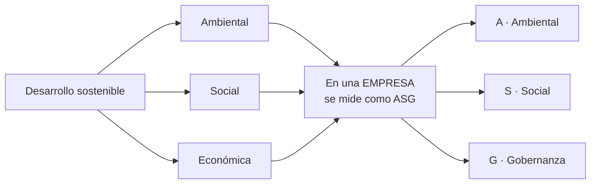
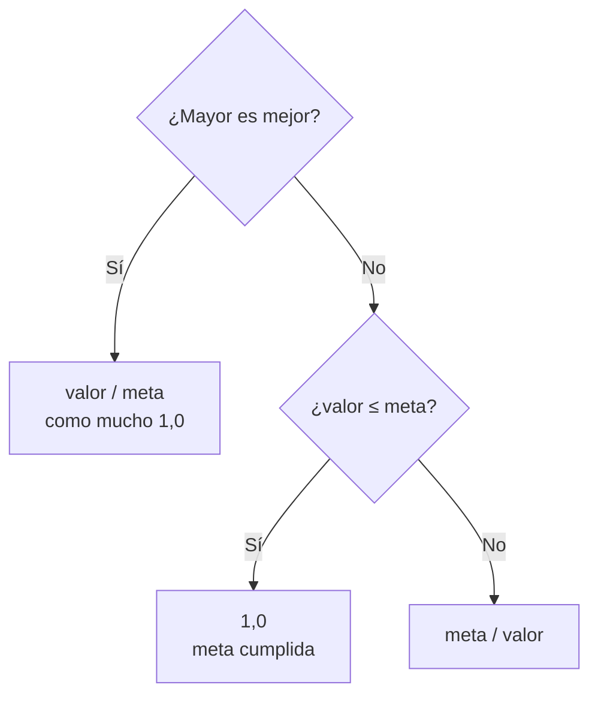
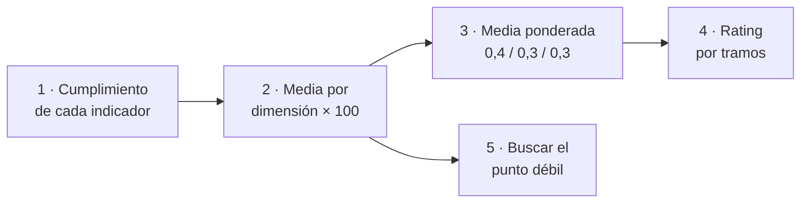
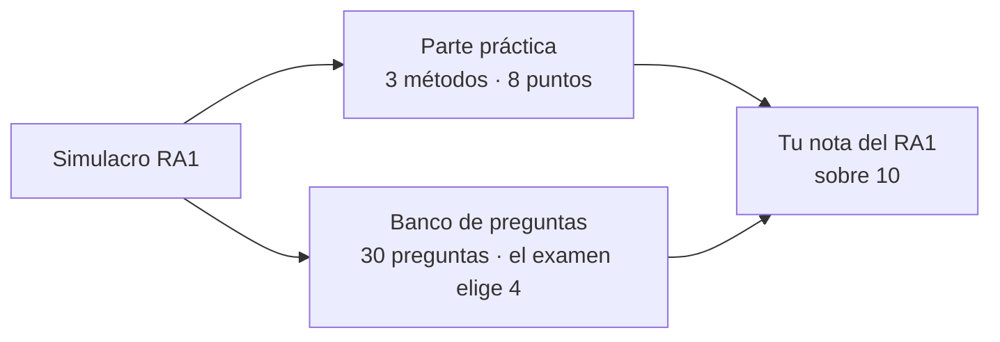

# UT1 · Sostenibilidad, ODS y criterios ASG

> **RA1** · 4 h · 12 % · Clase `Ut1Asg.java` · `mvn test -Dtest=Ut1AsgTest`

Al terminar esta unidad sabrás **poner nota a una empresa** en sostenibilidad, igual que hacen las agencias a las que miran los fondos de inversión. Con código, no con opiniones.

---

## 1. Teoría en cinco minutos

**Desarrollo sostenible** (Informe Brundtland, 1987): el que atiende las necesidades actuales **sin comprometer** las de las generaciones futuras.



La dimensión económica se convierte en **gobernanza**: cómo se dirige y controla la empresa.

| Dimensión | Qué mide | Ejemplo real |
|---|---|---|
| **A**mbiental | Emisiones, energía, agua, residuos | % de electricidad renovable del centro de datos |
| **S**ocial | Empleo, igualdad, formación, accesibilidad | Brecha salarial de género |
| **G**obernanza | Ética, transparencia, cumplimiento | Plantilla formada en el código ético |

**La Agenda 2030** (ONU, 2015) fija **17 ODS** y 169 metas. Los que más tocan al desarrollo web: **7** energía, **10** desigualdades y accesibilidad, **12** consumo responsable, **13** clima, **16** transparencia y datos.

**El concepto que más se falla:** cada indicador tiene una **dirección**.

| Indicador | Dirección | Si el número sube… |
|---|---|---|
| % electricidad renovable | mayor es mejor | mejora |
| Toneladas de CO₂ emitidas | menor es mejor | **empeora** |
| Brecha salarial (%) | menor es mejor | **empeora** |

!!! warning "Rigor"
    Toda cifra lleva su fuente. Decir «somos una empresa verde» sin datos es **greenwashing**, y la normativa europea lo persigue.

---

## 2. Batería de ejercicios

> Seis ejercicios en orden. Cada uno prepara una pieza del reto final: si los haces todos, el reto lo tendrás medio hecho. Cada ejercicio tiene **enunciado, datos y el resultado que debe salir**, para que puedas comprobarte solo.

---

### Ejercicio 1 · ¿Este indicador ha mejorado?

**Qué tienes que hacer.** Para cada indicador, di si **conviene que suba o que baje** y después si ha mejorado o empeorado de 2024 a 2025.

| Indicador | 2024 | 2025 |
|---|---:|---:|
| Electricidad renovable (%) | 65 | 72 |
| Emisiones (t CO₂e) | 380 | 410 |
| Horas de formación por persona | 24 | 28 |
| Brecha salarial de género (%) | 11 | 9 |

??? success "Solución"

    | Indicador | Dirección | 2024 → 2025 | ¿Mejora? |
    |---|---|---|:-:|
    | Electricidad renovable | **mayor es mejor** | 65 → 72 (sube) | **Sí** |
    | Emisiones | **menor es mejor** | 380 → 410 (sube) | **No** |
    | Horas de formación | **mayor es mejor** | 24 → 28 (sube) | **Sí** |
    | Brecha salarial | **menor es mejor** | 11 → 9 (baja) | **Sí** |

    **Lo importante:** en tres de los cuatro el número sube, pero solo en dos eso es una buena noticia. Un programa que no sepa la dirección de cada indicador dará resultados al revés. Por eso los métodos que comparan con una meta llevan el parámetro `mayorEsMejor`.


---

### Ejercicio 2 · Calcular el cumplimiento a mano

El **cumplimiento** responde a una sola pregunta: **¿cuánto le falta a este indicador para llegar a su meta?** Es un número entre 0 y 1:

| Cumplimiento | Significa |
|:-:|---|
| **1,0** | Meta conseguida |
| **0,5** | A medio camino |
| **0,0** | Nada conseguido |

Se calcula de forma distinta según la **dirección** del indicador.

#### Caso 1 · Mayor es mejor

*Ejemplo: porcentaje de electricidad renovable.* La meta es **llegar** a un número. Divides lo que tienes entre lo que quieres:

```text
cumplimiento = valor / meta
```

| Meta | Valor | Cuenta | Cumplimiento |
|---:|---:|---|---:|
| 100 % | 50 % | 50 / 100 | **0,50** · vas por la mitad |
| 100 % | 72 % | 72 / 100 | **0,72** |
| 80 % | 95 % | 95 / 80 = 1,19 → **se corta en 1,0** | **1,00** |

Si te pasas de la meta, el cumplimiento se queda en **1,0**: la meta está conseguida, y no existe el «119 % conseguido».

#### Caso 2 · Menor es mejor

*Ejemplo: toneladas de CO₂ emitidas.* La meta es **no pasar** de un número. Hay dos situaciones:

- Si estás **por debajo o justo en la meta**, la has cumplido: **1,0**.
- Si te has **pasado**, divides **al revés**:

```text
cumplimiento = meta / valor
```

| Meta | Emites | Situación | Cumplimiento |
|---:|---:|---|---:|
| 350 t | 300 t | por debajo de la meta | **1,00** |
| 350 t | 350 t | justo en la meta | **1,00** |
| 350 t | 410 t | te has pasado | 350 / 410 = **0,85** |
| 350 t | 700 t | emites el doble de lo permitido | 350 / 700 = **0,50** |

**¿Por qué se divide al revés?** Porque aquí, cuanto **más** emites, **peor**. Si el valor va abajo, cuanto más grande es, más pequeño sale el resultado: emitir el doble de lo permitido da 0,5; el triple, 0,33. Si dividieras `valor / meta` saldría 2,0, y parecería que emitir el doble es **mejor**.

#### ¿Y si la meta es 0?

Pasa con metas como «cero accidentes» o «cero residuos al vertedero», que siempre son de **menor es mejor**. No hace falta ninguna regla nueva: se aplica la del caso 2.

| Meta | Valor | Cuenta | Cumplimiento |
|---:|---:|---|---:|
| 0 | 0 | no te has pasado → cumplida | **1,00** |
| 0 | 1 | te has pasado → 0 / 1 | **0,00** |
| 0 | 9 | te has pasado → 0 / 9 | **0,00** |

!!! warning "Con meta 0 es todo o nada"
    Da igual 9 accidentes que 1: los dos dan **0,00**. Pasar de 10 accidentes a 1 es una mejora enorme y el cumplimiento no la ve. No es un error del código: es una **limitación** de esta forma de medir. En la **UT6** aprenderás la forma buena para estos casos: comparar con el valor del que partías.

#### Todo junto



**Qué tienes que hacer.** Calcula el cumplimiento de estos cuatro casos, con dos decimales.

| # | Valor | Meta | Dirección |
|:-:|---:|---:|---|
| a | 72 | 100 | mayor es mejor |
| b | 95 | 80 | mayor es mejor |
| c | 410 | 350 | menor es mejor |
| d | 10 | 0 | menor es mejor |

??? success "Solución"

    | # | Cuenta | Resultado |
    |:-:|---|---:|
    | a | `72 / 100` | **0,72** |
    | b | `95 / 80 = 1,19` → tope | **1,00** |
    | c | 410 > 350, así que `350 / 410` | **0,85** |
    | d | 10 > 0, así que `0 / 10` | **0,00** |

    **El caso b** se acota porque no existe el 119 % de cumplimiento: si no, una empresa taparía tres indicadores malos con uno espectacular.

    **El caso d** es una meta de «cero residuos al vertedero» y se enviaron 10 t: te has pasado, así que el cumplimiento es 0. Con meta 0, cualquier valor por encima da 0 (recuerda el aviso de «todo o nada»).


---

### Ejercicio 3 · Escribir `cumplimiento` en Java

**Qué tienes que hacer.** Escribe este método:

```java
double cumplimiento(double valor, double meta, boolean mayorEsMejor)
```

Debe devolver exactamente los resultados del ejercicio 2. Es el **método 2 del reto final**, así que lo que escribas aquí te vale tal cual.

??? success "Solución"

    ```java
    double cumplimiento(double valor, double meta, boolean mayorEsMejor) {
        if (mayorEsMejor) {
            return Math.min(1.0, valor / meta);     // (1) caso 1
        }
        if (valor <= meta) return 1.0;              // (2) caso 2, no te has pasado
        return meta / valor;                        // (3) caso 2, te has pasado
    }
    ```

    1. Lo que tienes entre lo que quieres. `Math.min(1.0, …)` pone el tope: si sale 1,19, devuelve 1,0.
    2. Con «menor es mejor», estar por debajo de la meta o justo en ella es cumplirla del todo.
    3. Te has pasado: se divide al revés. Aquí nunca se divide entre 0, porque si llegas a esta línea es que `valor` es mayor que `meta`.

    **Compruébalo** con los cuatro casos del ejercicio 2 antes de seguir.


---

### Ejercicio 4 · El semáforo del cuadro de mando

La dirección no quiere ver decimales, quiere colores:

| Cumplimiento | Color |
|---|---|
| Desde 0,90 | VERDE |
| Desde 0,70 hasta menos de 0,90 | AMBAR |
| Por debajo de 0,70 | ROJO |

**Qué tienes que hacer.** Escribe `String semaforo(double cumplimiento)`. Si el valor no está entre 0 y 1, lanza `IllegalArgumentException`. Después aplícalo a los cuatro resultados del ejercicio 2.

??? success "Solución"

    ```java
    String semaforo(double cumplimiento) {
        if (cumplimiento < 0 || cumplimiento > 1) {                     // (1)
            throw new IllegalArgumentException("Fuera de rango: " + cumplimiento);
        }
        if (cumplimiento >= 0.90) return "VERDE";                        // (2)
        if (cumplimiento >= 0.70) return "AMBAR";
        return "ROJO";
    }
    ```

    1. Validar primero evita tener que repetir comprobaciones después.
    2. Los tramos se comprueban **de mayor a menor**. Si los pusieras al revés, el primer `if` se tragaría todos los casos.

    Aplicado al ejercicio 2: 0,72 → **AMBAR** · 1,00 → **VERDE** · 0,85 → **AMBAR** · 0,00 → **ROJO**.


---

### Ejercicio 5 · Puntuar una dimensión entera

La puntuación de una dimensión es la **media de los cumplimientos de sus indicadores, multiplicada por 100** y redondeada a un decimal.

**Qué tienes que hacer.** Escribe `double puntuacionDimension(double[] cumplimientos)` y calcula la dimensión ambiental con estos tres indicadores:

| Indicador | Cumplimiento |
|---|---:|
| Renovables | 0,720 |
| Emisiones | 0,854 |
| Residuos reutilizados | 0,633 |

Si el array llega vacío, el método debe devolver `0.0` (no lanzar excepción).

??? success "Solución"

    ```java
    double puntuacionDimension(double[] cumplimientos) {
        if (cumplimientos.length == 0) return 0.0;          // (1)
        double suma = 0;
        for (double c : cumplimientos) suma += c;
        double media = suma / cumplimientos.length;
        return Math.round(media * 100 * 10) / 10.0;         // (2)
    }
    ```

    1. Sin esto, dividirías entre cero. Devolver 0 es lo correcto: una dimensión sin indicadores no ha demostrado nada.
    2. Dos pasos en una línea. `media * 100` pasa de la escala 0-1 a la escala 0-100. Después viene el truco del redondeo a un decimal: multiplicas por 10, redondeas al entero y divides entre 10,0. El `.0` es imprescindible, o Java haría una división entera.

    **Resultado:** `(0,720 + 0,854 + 0,633) / 3 = 0,736` → **73,6**

    ```text
    Renovables      ███████████████████████████████████░░░░░░░░░░░░░  72,0
    Emisiones       ██████████████████████████████████████████░░░░░░  85,4
    Residuos        ███████████████████████████░░░░░░░░░░░░░░░░░░░░░  63,3
                    ────────────────────────────────────────────────
    DIMENSIÓN A     ████████████████████████████████████░░░░░░░░░░░░  73,6
    ```


---

### Ejercicio 6 · La nota global y el rating

La puntuación global **no** es la media de las tres dimensiones: la ambiental pesa más.

```text
global = ambiental × 0,4 + social × 0,3 + gobernanza × 0,3
```

Y el rating sale de esa nota: **≥ 85 AAA · ≥ 70 AA · ≥ 55 A · ≥ 40 BBB · ≥ 25 BB · resto B**.

**Qué tienes que hacer.** Una empresa saca 50 en ambiental, 80 en social y 90 en gobernanza.

1. Calcula la global ponderada y su rating.
2. Calcula también la **media simple** de las tres.
3. Explica en una frase por qué la diferencia importa.

??? success "Solución"

    1. `50 × 0,4 + 80 × 0,3 + 90 × 0,3 = 20 + 24 + 27 = ` **71,0** → rating **AA**
    2. Media simple: `(50 + 80 + 90) / 3 = ` **73,3**
    3. Son **2,3 puntos de diferencia** solo por cómo se pondera. Con otros pesos, la misma empresa podría quedarse en **A**. Por eso las agencias publican su metodología: sin saber cómo se pondera, un rating no se puede interpretar ni comparar con el de otra agencia.

    ```java
    double puntuacionAsg(double ambiental, double social, double gobernanza) {
        double total = ambiental * 0.4 + social * 0.3 + gobernanza * 0.3;
        return Math.round(total * 10) / 10.0;
    }
    ```


---

## 3. Reto ejemplo (resuelto)

> Aquí se juntan los seis ejercicios en un programa que hace el trabajo completo. Léelo entero: el reto que tienes que entregar es exactamente igual, con otra empresa.

### El encargo

Una consultora te pasa los indicadores de **NubeVerde Hosting S.L.** y te pide su **radar ASG**: la nota de cada dimensión, la nota global, el rating y cuál es el punto más débil.

| Indicador | Dim. | Valor | Meta | Dirección |
|---|:-:|---:|---:|---|
| Electricidad renovable en el centro de datos (%) | A | 72 | 100 | mayor |
| Emisiones alcance 1 y 2 (t CO₂e) | A | 410 | 350 | menor |
| Residuos electrónicos reutilizados (%) | A | 38 | 60 | mayor |
| Horas de formación por persona | S | 28 | 40 | mayor |
| Brecha salarial de género (%) | S | 9 | 5 | menor |
| Plantilla formada en código ético (%) | G | 91 | 100 | mayor |

### Cómo se resuelve, paso a paso



1. **Cada indicador** pasa por `cumplimiento(valor, meta, dirección)` y da un número entre 0 y 1.
2. **Los de cada dimensión** se agrupan en un array y se resumen con `puntuacionDimension`.
3. **Las tres notas** se combinan con `puntuacionAsg`, que aplica los pesos.
4. **La nota global** se traduce a letras con `rating`.
5. **El punto débil**: miramos la tabla de cumplimientos, elegimos el más bajo y le aplicamos `semaforo`.

### El programa

Crea el fichero `src/main/java/sostenibilidad/DemoUt1.java` y ejecútalo con el botón de *play* del IDE:

```java
package sostenibilidad;

public class DemoUt1 {
    public static void main(String[] args) {
        // Paso 1 y 2: cumplimientos agrupados por dimensión
        double[] amb = {
            Ut1Asg.cumplimiento(72, 100, true),      // renovables      -> 0,720
            Ut1Asg.cumplimiento(410, 350, false),    // emisiones       -> 0,854
            Ut1Asg.cumplimiento(38, 60, true)};      // residuos        -> 0,633
        double[] soc = {
            Ut1Asg.cumplimiento(28, 40, true),       // formación       -> 0,700
            Ut1Asg.cumplimiento(9, 5, false)};       // brecha salarial -> 0,556
        double[] gob = {
            Ut1Asg.cumplimiento(91, 100, true)};     // código ético    -> 0,910

        double a = Ut1Asg.puntuacionDimension(amb);
        double s = Ut1Asg.puntuacionDimension(soc);
        double g = Ut1Asg.puntuacionDimension(gob);

        // Paso 3 y 4: nota global y rating
        double total = Ut1Asg.puntuacionAsg(a, s, g);

        System.out.printf("A=%.1f  S=%.1f  G=%.1f%n", a, s, g);
        System.out.printf("ASG=%.1f  rating=%s%n", total, Ut1Asg.rating(total));

        // Paso 5: el punto débil (el cumplimiento más bajo de la tabla)
        double peor = Ut1Asg.cumplimiento(9, 5, false);
        System.out.printf("Peor indicador: brecha salarial (%.3f) -> %s%n",
                peor, Ut1Asg.semaforo(peor));
    }
}
```

### La salida

```text
A=73,6  S=62,8  G=91,0
ASG=75,6  rating=AA
Peor indicador: brecha salarial (0,556) -> ROJO
```

```text
Ambiental    ████████████████████████████████████░░░░░░░░░░░░  73,6
Social       ███████████████████████████████░░░░░░░░░░░░░░░░░  62,8
Gobernanza   ████████████████████████████████████████████░░░░  91,0
──────────────────────────────────────────────────────────────
GLOBAL                                                          75,6 → AA
```

### Qué significa este resultado

**La nota que irá en la portada es un AA**, y suena muy bien. Pero mira el detalle:

- La **gobernanza va 28 puntos por encima** de lo social. Es lo más barato de cumplir: formar a la plantilla en un código ético cuesta una tarde.
- Lo **social es la dimensión más débil** (62,8), y dentro de ella la **brecha salarial está en rojo**: 0,556 de cumplimiento, el peor indicador de la empresa con diferencia.

**La conclusión profesional:** la acción prioritaria de esta empresa no es la que sale en su portada. Es la brecha salarial. Y eso solo se ve bajando del rating global al indicador concreto, que es exactamente lo que hace un analista ASG y lo que acabas de programar.

---

## 4. Reto a realizar (entregable)

> Dos partes. La primera es el código; la segunda, aplicarlo a una empresa. Nada más.

### Parte 1 · Completa la clase `Ut1Asg.java`

Escribe los 8 métodos hasta que pasen los **24 tests**:

```bash
mvn test -Dtest=Ut1AsgTest
```

Cuatro de los ocho ya los has hecho en la batería. Estos son los otros cuatro:

| # | Método | Qué debe hacer | Pista |
|:-:|---|---|---|
| 1 | `clasificar` | Devuelve `"AMBIENTAL"`, `"SOCIAL"`, `"GOBERNANZA"` o `"SIN CLASIFICAR"` según el texto del tema | Llama a `normalizar(tema)`, que ya está escrito, y recorre los tres arrays de palabras **en ese orden** usando `texto.contains(palabra)` |
| 6 | `rating` | Traduce la nota a letras | Valida el rango 0-100 y después seis `if` de mayor a menor |
| 7 | `haMejorado` | Compara dos años en la dirección correcta | Una sola línea con un ternario y `mayorEsMejor` |
| 8 | `odsCubiertos` | Devuelve los ODS válidos (1-17), ordenados y sin repetir | `TreeSet<Integer>` ordena y quita duplicados solo; después vuélcalo a `int[]` con un bucle y un contador |

!!! tip "No te atasques"
    Lanza los tests **antes** de escribir nada: verás 24 fallos. Cada test empieza por el número del método que comprueba (`M2 · cumplimiento cuando mayor es mejor` es del método 2). Ve resolviéndolos de uno en uno.

### Parte 2 · Calcula el radar de esta empresa

Cuando los tests estén en verde, copia el programa `DemoUt1` del reto ejemplo, cambia los datos por los de **Datalia Software S.L.** y ejecútalo:

| Indicador | Dim. | Valor | Meta | Dirección |
|---|:-:|---:|---:|---|
| Electricidad renovable (%) | A | 45 | 100 | mayor |
| Emisiones alcance 1 y 2 (t CO₂e) | A | 520 | 500 | menor |
| Agua reciclada en refrigeración (%) | A | 20 | 50 | mayor |
| Horas de formación por persona | S | 35 | 40 | mayor |
| Web conforme a WCAG 2.2 AA (%) | S | 60 | 100 | mayor |
| Consejo con miembros independientes (%) | G | 30 | 50 | mayor |
| Plantilla formada en código ético (%) | G | 100 | 100 | mayor |

**Entrega un documento de una página con:**

1. La **tabla de cumplimientos** de los siete indicadores, con su semáforo.
2. Las **tres notas de dimensión**, la **nota global** y el **rating**.
3. **Tres frases** respondiendo a estas tres preguntas:
      - ¿Cuál es la dimensión más débil?
      - ¿Cuál es el peor indicador concreto y qué semáforo tiene?
      - Si la empresa solo pudiera mejorar **un** indicador el año que viene, ¿cuál elegirías y por qué?

!!! warning "Pista para la tercera pregunta"
    El peor indicador y el más rentable de mejorar **no tienen por qué ser el mismo**. Piensa qué dimensión pesa más en la nota global y cuánto margen hay hasta la meta en cada caso.

---

## 5. Simulacro de examen

> **Esta es la evaluación de la unidad.** Tiene el mismo formato que la parte de RA1 del examen del trimestre, y **las preguntas de test del examen salen de este banco**. Si dominas esta sección, tienes el RA1 preparado.



### Parte práctica · 8 puntos

Hazla **en 40 minutos**, sin mirar la batería ni tu reto. Abre `src/main/java/simulacro/SimulacroRa1.java`, completa los 3 métodos y lanza:

```bash
mvn test -Dtest=SimulacroRa1Test
```

```text
nota práctica = (tests superados ÷ 13) × 8
```

!!! warning "Las reglas no son las de clase"
    Cambian pesos, umbrales o redondeos, y el Javadoc lo avisa en mayúsculas. Es el fallo número uno del examen: código correcto con las constantes de clase.

### Banco de preguntas · 2 puntos

En el examen salen **4 preguntas de este banco**, a 0,5 puntos cada una. Para practicar, tápate las respuestas y hazlas todas.

Son preguntas **sencillas**: si has entendido la teoría y has hecho la batería, salen solas. Los cálculos llevan números redondos y se hacen de cabeza.

#### A · Conceptos

**1.** El desarrollo sostenible (Informe Brundtland, 1987) atiende las necesidades actuales…

a) reduciendo a cero las emisiones · b) sin comprometer las de las generaciones futuras · c) dando prioridad a la economía · d) solo en los países desarrollados

??? success "Respuesta"

    **b**. Es la definición de la unidad.

**2.** Las tres dimensiones del desarrollo sostenible son…

a) ambiental, social y económica · b) energía, agua y residuos · c) local, nacional y global · d) pública, privada y mixta

??? success "Respuesta"

    **a**. En una empresa se miden como A, S y G.

**3.** Cuando se mide la sostenibilidad de una **empresa**, esas tres dimensiones se llaman…

a) ODS · b) PIB · c) ASG · d) ISO

??? success "Respuesta"

    **c**. Ambiental, Social y Gobernanza.

**4.** En ASG, la letra **G** significa…

a) Gestión · b) Gasto · c) Garantía · d) Gobernanza

??? success "Respuesta"

    **d**. Cómo se dirige y controla la empresa.

**5.** La gobernanza mide…

a) cómo se dirige y controla la empresa: ética, transparencia y cumplimiento · b) cuánto factura la empresa · c) cuánta energía consume · d) cuántas personas tiene en plantilla

??? success "Respuesta"

    **a**. Es la dimensión económica del desarrollo sostenible vista desde dentro de la empresa.

**6.** La Agenda 2030 de la ONU fija…

a) 10 ODS · b) 17 ODS · c) 169 ODS · d) 30 ODS

??? success "Respuesta"

    **b**. 17 objetivos y 169 metas. 169 son las metas, no los objetivos.

**7.** ¿Qué ODS trata la **acción por el clima**?

a) ODS 7 · b) ODS 10 · c) ODS 16 · d) ODS 13

??? success "Respuesta"

    **d**. El 7 es energía, el 10 desigualdades y el 16 transparencia e instituciones.

**8.** ¿Qué ODS trata la **energía**?

a) ODS 7 · b) ODS 12 · c) ODS 13 · d) ODS 16

??? success "Respuesta"

    **a**. Energía asequible y no contaminante.

**9.** Hacer una web accesible para personas con discapacidad conecta sobre todo con el…

a) ODS 13 · b) ODS 7 · c) ODS 10 · d) ODS 16

??? success "Respuesta"

    **c**. Reducción de las desigualdades, que incluye la accesibilidad.

**10.** Una empresa se anuncia como «empresa verde» sin aportar ningún dato. Eso es…

a) un indicador ASG · b) greenwashing · c) un rating · d) una meta

??? success "Respuesta"

    **b**. Toda cifra lleva su fuente; sin datos, es greenwashing.

#### B · Indicadores: dimensión y dirección

**11.** «Porcentaje de electricidad renovable del centro de datos» es un indicador…

a) social · b) de gobernanza · c) ambiental · d) que no es ASG

??? success "Respuesta"

    **c**. Mide energía.

**12.** «Brecha salarial de género» es un indicador…

a) social · b) ambiental · c) de gobernanza · d) que no es ASG

??? success "Respuesta"

    **a**. Mide igualdad entre personas de la plantilla.

**13.** «Porcentaje de la plantilla formada en el código ético» es un indicador…

a) ambiental · b) social · c) que no es ASG · d) de gobernanza

??? success "Respuesta"

    **d**. Mide ética y cumplimiento.

**14.** «Porcentaje de consejeros independientes» es un indicador…

a) ambiental · b) de gobernanza · c) social · d) que no es ASG

??? success "Respuesta"

    **b**. Mide cómo se dirige y controla la empresa.

**15.** ¿En cuál de estos indicadores conviene que el número **baje**?

a) % de electricidad renovable · b) horas de formación por persona · c) % de plantilla formada · d) toneladas de CO₂ emitidas

??? success "Respuesta"

    **d**. Es un indicador de «menor es mejor».

**16.** Las emisiones de una empresa pasan de 380 t a 410 t. El indicador…

a) ha mejorado · b) ha empeorado · c) no ha cambiado · d) no se puede saber

??? success "Respuesta"

    **b**. Sube un indicador de «menor es mejor».

**17.** La brecha salarial pasa del 11 % al 9 %. El indicador…

a) ha mejorado · b) ha empeorado · c) no ha cambiado · d) no se puede saber

??? success "Respuesta"

    **a**. Baja un indicador de «menor es mejor».

**18.** Que el número de un indicador suba, ¿es siempre una buena noticia?

a) sí, siempre · b) solo en la dimensión social · c) no: depende de si en ese indicador mayor o menor es mejor · d) solo si tiene meta

??? success "Respuesta"

    **c**. Por eso el método `cumplimiento` lleva el parámetro `mayorEsMejor`.

#### C · Cálculos sencillos

**19.** Mayor es mejor. Meta 100 %, valor 50 %. El cumplimiento es…

a) 0,5 · b) 2,0 · c) 50 · d) 1,0

??? success "Respuesta"

    **a**. valor / meta = 50 / 100.

**20.** Mayor es mejor. Meta 80, valor 100. El cumplimiento es…

a) 1,25 · b) 0,8 · c) 0,2 · d) 1,0

??? success "Respuesta"

    **d**. 100 / 80 = 1,25, pero se corta en 1,0: la meta está conseguida.

**21.** Menor es mejor. Meta 400 t y se emiten 300 t. El cumplimiento es…

a) 0,75 · b) 1,0 · c) 1,33 · d) 0,0

??? success "Respuesta"

    **b**. Está por debajo de la meta: cumplida.

**22.** Menor es mejor. Meta 200 t y se emiten 400 t. El cumplimiento es…

a) 2,0 · b) 1,0 · c) 0,5 · d) 0,0

??? success "Respuesta"

    **c**. Se ha pasado, así que se divide al revés: meta / valor = 200 / 400.

**23.** Meta «cero accidentes» y ha habido 3. El cumplimiento es…

a) 0,33 · b) 1,0 · c) excepción · d) 0,0

??? success "Respuesta"

    **d**. Con meta 0 es todo o nada: cualquier valor por encima da 0.

**24.** Los indicadores de una dimensión tienen cumplimientos 1,0 · 0,8 · 0,6. Su puntuación es…

a) 80,0 · b) 0,8 · c) 2,4 · d) 240

??? success "Respuesta"

    **a**. Media 0,8, multiplicada por 100.

**25.** A = 100, S = 50, G = 50, con pesos 0,4 / 0,3 / 0,3. La nota global es…

a) 66,7 · b) 60,0 · c) 70,0 · d) 75,0

??? success "Respuesta"

    **c**. 40 + 15 + 15. La a) sería la media simple.

**26.** Con los tramos ≥ 85 AAA · ≥ 70 AA · ≥ 55 A, una nota global de 70 tiene rating…

a) AAA · b) AA · c) A · d) BBB

??? success "Respuesta"

    **b**. AA empieza justo en 70.

#### D · Interpretar el resultado

**27.** Con el semáforo VERDE ≥ 0,90 · ÁMBAR ≥ 0,70 · ROJO por debajo, un cumplimiento de 0,75 es…

a) VERDE · b) ROJO · c) ÁMBAR · d) depende de la dimensión

??? success "Respuesta"

    **c**. Está entre 0,70 y 0,90.

**28.** ¿Por qué el cumplimiento tiene un tope de 1,0?

a) para no dividir entre cero · b) para que un indicador espectacular no tape a otros malos · c) porque Java no admite valores mayores · d) para redondear

??? success "Respuesta"

    **b**. No existe el «119 % conseguido».

**29.** En el reto ejemplo, NubeVerde saca **AA** pero tiene la brecha salarial en **rojo**. ¿Qué conclusión es correcta?

a) va bien, porque el rating es alto · b) el rating está mal calculado · c) la nota global puede esconder un indicador muy débil: hay que mirar el detalle · d) lo social no cuenta en el rating

??? success "Respuesta"

    **c**. La acción prioritaria no es la que sale en la portada.

**30.** Dos agencias dan ratings distintos a la misma empresa. Lo más probable es que…

a) usen indicadores o pesos distintos · b) una de las dos mienta · c) sea aleatorio · d) los ratings no sirvan para nada

??? success "Respuesta"

    **a**. Por eso las agencias publican su metodología.

### Tu nota del simulacro

```text
nota RA1 = (tests superados ÷ 13) × 8  +  aciertos en 4 preguntas × 0,5
```

Si sale por debajo de 5, vuelve a la batería de la unidad antes del examen del trimestre.
