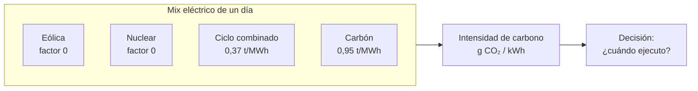
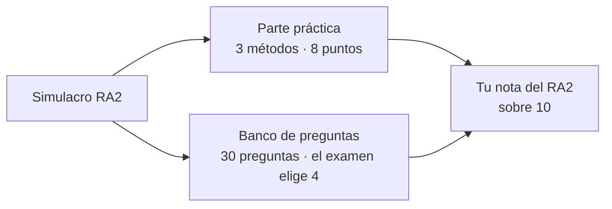

# UT2 · Retos ambientales y la huella de la electricidad

> **RA2** · 4 h · 15 % · Clase `Ut2Energia.java` · `mvn test -Dtest=Ut2EnergiaTest`

Aquí descubrirás algo que casi nadie sabe: **el mismo servidor, consumiendo lo mismo, puede emitir cinco veces más un martes que un jueves**. Y aprenderás a calcularlo.

---

## 1. Teoría en cinco minutos

**Retos ambientales:** cambio climático, pérdida de biodiversidad, contaminación, escasez de agua, agotamiento de recursos. **Sociales:** desigualdad, brecha digital, trabajo precario, desigualdad de género. Van juntos: una ola de calor golpea más a quien trabaja al aire libre. De ahí la **transición justa**.

**El sector digital no es inmaterial:**

| Impacto | Dato de referencia |
|---|---|
| Electricidad | Los centros de datos rondaban el **1,5 %** de la electricidad mundial en 2024 (IEA, *Energy and AI*, 2025) |
| Residuos electrónicos | **62 Mt** generadas en 2022, solo el **22,3 %** recogido formalmente (Global E-waste Monitor 2024) |
| Agua | Refrigeración de centros de datos, crítica en zonas con sequía |

**La clave técnica:** un kWh no siempre emite lo mismo.



```text
            Σ (MWh × factor t/MWh)
intensidad = ──────────────────────── × 1000   → g CO₂/kWh
                  Σ MWh totales
```

El `× 1000` sale de que **1 t/MWh = 1 000 000 g ÷ 1000 kWh = 1000 g/kWh**.

**Para reducir impactos, en este orden:**


| Paso | Qué significa | Ejemplo en informática |
|---|---|---|
| **Evitar** | Que ese consumo no exista | Eliminar un informe nocturno que nadie lee |
| **Reducir** | Consumir menos para lo mismo | Optimizar una consulta lenta; apagar servidores ociosos |
| **Sustituir** | Usar una fuente más limpia | Contratar electricidad renovable; lanzar los procesos cuando la red está más limpia |
| **Compensar** | Pagar para que otro reduzca | Comprar créditos de carbono |

Compensar es **el último** paso. Anunciarse como «neutro en carbono» solo comprando créditos, sin reducir, es greenwashing.

---

## 2. Batería de ejercicios

> Seis ejercicios en orden. Cada uno prepara una pieza del reto final. Todos traen **enunciado, datos y el resultado que debe salir**.

---

### Ejercicio 1 · El nombre que no coincide

**Qué tienes que hacer.** La API de Red Eléctrica devuelve los nombres así, y tu tabla de factores los tiene en minúsculas y sin tildes. Di, para cada uno, si `equals` los encontraría y qué factor saldría.

| Viene de la API | Está en la tabla como | ¿`equals` los encuentra? | Factor que saldría |
|---|---|:-:|---|
| `"Carbón"` | `"carbon"` | ? | ? |
| `"COGENERACIÓN"` | `"cogeneracion"` | ? | ? |
| `"ciclo combinado"` | `"ciclo combinado"` | ? | ? |

??? success "Solución"

    | Viene de la API | ¿Coincide? | Factor que saldría | Factor correcto |
    |---|:-:|---:|---:|
    | `"Carbón"` | **No** (tilde y mayúscula) | 0,00 | 0,95 |
    | `"COGENERACIÓN"` | **No** | 0,00 | 0,38 |
    | `"ciclo combinado"` | Sí | 0,37 | 0,37 |

    **Lo importante:** el fallo **no rompe el programa**. Devuelve un número perfectamente creíble, solo que el carbón habría emitido cero. En un cálculo de emisiones, un error silencioso es peor que una excepción.

    La solución es `Ut1Asg.normalizar(...)`, que ya escribiste en la UT1:

    ```java
    String t = Ut1Asg.normalizar(tecnologia);   // "Carbón" -> "carbon"
    ```


---

### Ejercicio 2 · Toneladas emitidas en un día

Cada tecnología tiene un **factor de emisión** en toneladas de CO₂ por MWh generado:

| Tecnología | Factor (t/MWh) |
|---|---:|
| Carbón | 0,95 |
| Motores diésel | 0,77 |
| Cogeneración | 0,38 |
| Ciclo combinado | 0,37 |
| Eólica, solar, hidráulica, nuclear | 0,00 |

**Qué tienes que hacer.** Calcula las toneladas emitidas en este día:

| Tecnología | MWh |
|---|---:|
| Eólica | 300 |
| Ciclo combinado | 200 |
| Nuclear | 500 |

??? success "Solución"

    ```text
    300 × 0,00  =    0 t   (eólica)
    200 × 0,37  =   74 t   (ciclo combinado)
    500 × 0,00  =    0 t   (nuclear)
                    ─────
                     74 t
    ```

    **Cuidado con un error frecuente:** los 800 MWh que no emiten **no se descartan**. Siguen contando, y mucho, en el ejercicio siguiente: son los que bajan la media.


---

### Ejercicio 3 · De toneladas por MWh a gramos por kWh

La **intensidad de carbono** es la media: cuánto CO₂ hay detrás de **cada kWh** consumido.

```text
            toneladas totales
intensidad = ───────────────── × 1000     → g CO₂/kWh
              MWh totales
```

El `× 1000` sale de que **1 t/MWh = 1 000 000 g ÷ 1 000 kWh = 1 000 g/kWh**.

**Qué tienes que hacer.**

1. Calcula la intensidad del día del ejercicio 2.
2. Escribe `double intensidad(String[] tecnologias, double[] mwh)`, que es el **método 4 del reto final**.
3. Explica qué debe devolver si el total de MWh es 0.

??? success "Solución"

    1. `74 t / 1000 MWh = 0,074 t/MWh → ` **74,0 g/kWh**

    2. ```java
       double intensidad(String[] tecnologias, double[] mwh) {
           double totalMwh = 0;
           for (double m : mwh) totalMwh += m;
           if (totalMwh == 0) return 0.0;                     // (1)
           double t = toneladas(tecnologias, mwh);            // (2)
           return Math.round(t / totalMwh * 1000 * 10) / 10.0;
       }
       ```

          1. Sin esta línea, dividirías entre cero y obtendrías `NaN`. Y `NaN` es contagioso: cualquier cuenta posterior también da `NaN`.
          2. Reutiliza el método del ejercicio 2 en lugar de repetir el bucle.

    3. **0.0**. No hay generación, así que no hay intensidad que calcular.


---

### Ejercicio 4 · El día sucio

**Qué tienes que hacer.** Calcula la intensidad y el porcentaje renovable de este día, y compáralo con el del ejercicio 3.

| Tecnología | MWh | ¿Renovable? |
|---|---:|:-:|
| Carbón | 100 | No |
| Ciclo combinado | 300 | No |
| Solar fotovoltaica | 100 | Sí |

??? success "Solución"

    **Toneladas:** `100 × 0,95 + 300 × 0,37 = 95 + 111 = 206 t`
    **Intensidad:** `206 / 500 × 1000 = ` **412,0 g/kWh** → semáforo **ROJO**
    **Renovable:** `100 / 500 = ` **20,0 %**

    ```text
    Día con viento  ████████░░░░░░░░░░░░░░░░░░░░░░░░░░░░░░░░░░░░░░░░   74,0 g/kWh  VERDE
    Día sin viento  ████████████████████████████████████████████████  412,0 g/kWh  ROJO
    ```

    **5,6 veces más CO₂ por cada kWh.** Y fíjate: el día sucio genera **menos** MWh en total (500 frente a 1000). No se trata de cuánta electricidad hay, sino de **con qué se ha fabricado**.


---

### Ejercicio 5 · Nuclear: dos preguntas distintas

**Qué tienes que hacer.** Responde para la energía nuclear:

1. ¿Emite CO₂ al generar electricidad?
2. ¿Es renovable?
3. ¿Por qué el código tiene dos métodos separados, `factorEmision` y `esRenovable`, en lugar de uno solo?

??? success "Solución"

    1. **No emite CO₂ al generar.** Por eso no está en la tabla de factores y `factorEmision("Nuclear")` devuelve 0,0.
    2. **No es renovable.** El uranio es un recurso finito, así que no está en `RENOVABLES`.
    3. Porque son **dos propiedades independientes**. Si las juntaras en un método tipo `esLimpia()`, tendrías que decidir qué responder con la nuclear y **cualquier respuesta sería incorrecta** en uno de los dos sentidos. Dos preguntas, dos métodos.

    | Tecnología | ¿Emite? | ¿Renovable? |
    |---|:-:|:-:|
    | Eólica | No | Sí |
    | Nuclear | No | **No** |
    | Ciclo combinado | Sí | No |


---

### Ejercicio 6 · Lo que emite tu servidor

**Qué tienes que hacer.** Un servidor del instituto consume **250 kWh al mes**. Calcula los kilos de CO₂ que emite si todo ese consumo ocurriera:

- un mes con la red a **74 g/kWh** (como el día limpio),
- un mes con la red a **412 g/kWh** (como el día sucio).

Escribe también `double kgCo2(double kwh, double gramosPorKwh)`, redondeando a 2 decimales.

??? success "Solución"

    ```text
    250 kWh × 74 g/kWh  = 18 500 g = 18,5 kg
    250 kWh × 412 g/kWh = 103 000 g = 103,0 kg
    ```

    ```java
    double kgCo2(double kwh, double gramosPorKwh) {
        return Math.round(kwh * gramosPorKwh / 1000 * 100) / 100.0;   // (1)
    }
    ```

    1. Se divide entre 1000 para pasar de gramos a kilos. El `* 100 … / 100.0` es el redondeo a dos decimales.

    **84,5 kg de diferencia** por el mismo consumo, la misma máquina y el mismo código. Lo único que cambia es **cuándo**. Ese es el dato que justifica toda la unidad.


---

## 3. Reto ejemplo (resuelto)

> Los seis ejercicios juntos en un programa que toma una decisión de verdad. Léelo entero: el reto que tienes que entregar es **exactamente igual, con otros datos**.

### El encargo

El departamento de sistemas lanza una vez por semana un **proceso de copias de seguridad** que consume **50 kWh**. Puede ejecutarse el lunes, el martes o el miércoles. Te pasan cómo se generó la electricidad esos tres días (en MWh) y te preguntan: **¿qué día conviene lanzarlo y cuánto se ahorra al año?**

| Tecnología | Lunes | Martes | Miércoles |
|---|---:|---:|---:|
| Eólica | 400 | 200 | 100 |
| Solar fotovoltaica | 100 | 100 | 200 |
| Nuclear | 300 | 300 | 300 |
| Ciclo combinado | 200 | 300 | 400 |
| Carbón | 0 | 100 | 0 |
| **Total** | **1000** | **1000** | **1000** |

### Cómo se resuelve, paso a paso


1. Para cada día, `intensidad`, `porcentajeRenovable` y `semaforoRed`.
2. `diaMasLimpio` devuelve la **posición** del mejor día. El peor se busca con el mismo bucle, comparando al revés.
3. `kgCo2(50, intensidad)` da los kilos del proceso cada uno de esos dos días.
4. La diferencia es el ahorro de una semana; por 52, el de un año.

### El programa

Crea el fichero `src/main/java/sostenibilidad/DemoUt2.java` y ejecútalo con el botón de *play* del IDE:

```java
package sostenibilidad;

public class DemoUt2 {
    public static void main(String[] args) {
        String[] tecnologias = {"Eólica", "Solar fotovoltaica", "Nuclear", "Ciclo combinado", "Carbón"};
        String[] dias = {"lunes", "martes", "miércoles"};
        double[][] mwh = {
            {400, 100, 300, 200,   0},     // lunes
            {200, 100, 300, 300, 100},     // martes
            {100, 200, 300, 400,   0}};    // miércoles
        double kwhProceso = 50;

        // Paso 1: intensidad, % renovable y semáforo de cada día
        double[] intensidades = new double[dias.length];
        for (int d = 0; d < dias.length; d++) {
            intensidades[d] = Ut2Energia.intensidad(tecnologias, mwh[d]);
            double renovable = Ut2Energia.porcentajeRenovable(tecnologias, mwh[d]);
            System.out.printf("%-10s %6.1f g/kWh  %5.1f %% renovable  %s%n",
                    dias[d], intensidades[d], renovable, Ut2Energia.semaforoRed(intensidades[d]));
        }

        // Paso 2: el día más limpio y el más sucio
        int mejor = Ut2Energia.diaMasLimpio(intensidades);
        int peor = 0;
        for (int i = 1; i < intensidades.length; i++) {
            if (intensidades[i] > intensidades[peor]) peor = i;
        }

        // Paso 3: kilos que emite el proceso cada uno de esos dos días
        double kgMejor = Ut2Energia.kgCo2(kwhProceso, intensidades[mejor]);
        double kgPeor = Ut2Energia.kgCo2(kwhProceso, intensidades[peor]);
        System.out.printf("Mejor día: %s -> %.2f kg%n", dias[mejor], kgMejor);
        System.out.printf("Peor día:  %s -> %.2f kg%n", dias[peor], kgPeor);

        // Paso 4: el ahorro, por semana y en un año
        double ahorro = kgPeor - kgMejor;
        System.out.printf("Ahorro: %.2f kg por semana, %.1f kg al año%n", ahorro, ahorro * 52);
    }
}
```

### La salida

```text
lunes        74,0 g/kWh   50,0 % renovable  VERDE
martes      206,0 g/kWh   30,0 % renovable  ROJO
miércoles   148,0 g/kWh   30,0 % renovable  AMBAR
Mejor día: lunes -> 3,70 kg
Peor día:  martes -> 10,30 kg
Ahorro: 6,60 kg por semana, 343,2 kg al año
```

```text
Lunes      ███████░░░░░░░░░░░░░░░   74,0 g/kWh  VERDE
Martes     ████████████████████░░  206,0 g/kWh  ROJO
Miércoles  ██████████████░░░░░░░░  148,0 g/kWh  ÁMBAR
```

### Qué significa este resultado

- **Lanzarlo el lunes en vez del martes ahorra 343 kg de CO₂ al año**, sin comprar nada: basta con cambiar una línea del `cron`.
- **Martes y miércoles tienen el mismo 30 % renovable**, pero el martes emite bastante más. ¿Por qué? Por los 100 MWh de **carbón**: ellos solos son 95 de las 206 t del día. El porcentaje renovable no lo cuenta todo; importa **con qué se cubre el resto**.
- **La nuclear es igual los tres días** y no explica ninguna diferencia: no emite, pero tampoco es renovable.

Un matiz honesto: los datos de una semana no garantizan los de la siguiente. Esto sirve para fijar una **política** («los procesos pesados, el día con más viento»), no para adivinar el futuro.

---

## 4. Reto a realizar (entregable)

> Dos partes: el código y aplicarlo a otros datos. Nada más.

### Parte 1 · Completa la clase `Ut2Energia.java`

```bash
mvn test -Dtest=Ut2EnergiaTest
```

Tres de los ocho ya los has hecho en la batería (`intensidad`, `kgCo2` y la idea de `factorEmision`). Estos son los demás:

| # | Método | Qué debe hacer | Pista |
|:-:|---|---|---|
| 1 | `factorEmision` | Factor de una tecnología; 0,0 si no está en la tabla | Normaliza y recorre `TECNOLOGIAS`; cuando `TECNOLOGIAS[i]` coincida, devuelve `FACTORES[i]` |
| 2 | `esRenovable` | Si la tecnología está en `RENOVABLES` | Mismo patrón, pero solo hace falta `true` o `false` |
| 3 | `toneladas` | Suma de `mwh[i] × factor` | Un bucle; los dos arrays van en paralelo |
| 5 | `porcentajeRenovable` | Qué parte de la generación es renovable | **Un solo bucle** acumulando dos sumas: el total y la parte renovable |
| 6 | `semaforoRed` | VERDE < 100, AMBAR < 200, ROJO desde 200 | Valida el negativo primero |
| 8 | `diaMasLimpio` | **Posición** del menor; −1 si el array está vacío | Guarda el índice del mínimo y cambia solo si encuentras uno **estrictamente menor** |

### Parte 2 · Decide qué día lanzar el proceso

Con los tests en verde, copia el programa `DemoUt2` del reto ejemplo y cambia **solo los datos**. Ahora el proceso consume **80 kWh**, se lanza una vez por semana y puede ir el jueves, el viernes o el sábado:

| Tecnología | Jueves | Viernes | Sábado |
|---|---:|---:|---:|
| Eólica | 100 | 300 | 500 |
| Hidráulica | 100 | 100 | 100 |
| Nuclear | 300 | 300 | 300 |
| Ciclo combinado | 400 | 300 | 100 |
| Carbón | 100 | 0 | 0 |

**Entrega media página con:**

1. La **salida del programa**.
2. **Dos frases** respondiendo a:
      - ¿Qué día recomiendas lanzar el proceso y cuánto CO₂ se ahorra al año frente al peor día?
      - Viernes y sábado tienen la misma nuclear y no tienen carbón. ¿Qué explica que el sábado sea mucho más limpio?

---

## 5. Simulacro de examen

> **Esta es la evaluación de la unidad.** Tiene el mismo formato que la parte de RA2 del examen del trimestre, y **las preguntas de test del examen salen de este banco**. Si dominas esta sección, tienes el RA2 preparado.



### Parte práctica · 8 puntos

Hazla **en 40 minutos**, sin mirar la batería ni tu reto. Abre `src/main/java/simulacro/SimulacroRa2.java`, completa los 3 métodos y lanza:

```bash
mvn test -Dtest=SimulacroRa2Test
```

```text
nota práctica = (tests superados ÷ 7) × 8
```

!!! warning "Las reglas no son las de clase"
    Cambian pesos, umbrales o redondeos, y el Javadoc lo avisa en mayúsculas. Es el fallo número uno del examen: código correcto con las constantes de clase.

### Banco de preguntas · 2 puntos

En el examen salen **4 preguntas de este banco**, a 0,5 puntos cada una. Para practicar, tápate las respuestas y hazlas todas.

Son preguntas **sencillas**: si has entendido la teoría y has hecho la batería, salen solas. Los cálculos llevan números redondos y se hacen de cabeza.

#### A · Retos ambientales y sociales

**1.** ¿Cuál de estos es un reto **social**?

a) pérdida de biodiversidad · b) escasez de agua · c) brecha digital · d) contaminación

??? success "Respuesta"

    **c**. Los otros tres son retos ambientales.

**2.** ¿Cuál de estos es un reto **ambiental**?

a) agotamiento de recursos · b) trabajo precario · c) desigualdad de género · d) brecha digital

??? success "Respuesta"

    **a**. Los otros tres son retos sociales.

**3.** Una ola de calor perjudica más a quien trabaja al aire libre. Esto muestra que…

a) el cambio climático solo es un problema ambiental · b) los retos ambientales y sociales van juntos · c) hay que dejar de trabajar en verano · d) el problema es solo económico

??? success "Respuesta"

    **b**. De ahí la idea de transición justa.

**4.** La transición justa consiste en…

a) repartir las emisiones por igual entre países · b) cobrar una tasa por contaminar · c) cerrar todas las industrias contaminantes · d) descarbonizar sin dejar atrás a trabajadores ni territorios

??? success "Respuesta"

    **d**. Reducir emisiones teniendo en cuenta a quién afecta el cambio.

**5.** Los centros de datos consumían en 2024 cerca de qué parte de la electricidad mundial…

a) 0,01 % · b) 1,5 % · c) 15 % · d) 50 %

??? success "Respuesta"

    **b**. Dato de la IEA (2025).

**6.** Del residuo electrónico generado en 2022 se recogió formalmente…

a) casi todo · b) la mitad · c) algo más de una quinta parte · d) nada

??? success "Respuesta"

    **c**. El 22,3 % de 62 Mt.

**7.** ¿Por qué se dice que el sector digital **no es inmaterial**?

a) porque consume electricidad y agua y genera residuos electrónicos · b) porque usa mucho papel · c) porque no emite CO₂ · d) porque los datos pesan

??? success "Respuesta"

    **a**. Detrás de cada servicio web hay máquinas, refrigeración y aparatos que acaban como residuo.

#### B · La intensidad de carbono

**8.** La intensidad de carbono de la red eléctrica indica…

a) cuánta electricidad se genera en un día · b) el precio del kWh · c) cuánto CO₂ hay detrás de cada kWh consumido · d) el porcentaje renovable

??? success "Respuesta"

    **c**. Es una media: CO₂ emitido entre electricidad generada.

**9.** La intensidad de carbono se mide en…

a) kWh · b) €/MWh · c) t/año · d) g CO₂/kWh

??? success "Respuesta"

    **d**. Gramos de CO₂ por cada kWh.

**10.** ¿Cuál es la fórmula de la intensidad?

a) toneladas totales ÷ MWh totales × 1000 · b) MWh totales ÷ toneladas totales × 1000 · c) toneladas totales × MWh totales · d) MWh renovables ÷ MWh totales

??? success "Respuesta"

    **a**. La d) es el porcentaje renovable (sin el × 100).

**11.** En esa fórmula, ¿por qué se multiplica por 1000?

a) para redondear · b) porque 1 t/MWh equivale a 1000 g/kWh · c) para pasarlo a porcentaje · d) para quitar los decimales

??? success "Respuesta"

    **b**. 1 000 000 g ÷ 1000 kWh = 1000 g/kWh.

**12.** ¿Qué tecnología tiene el factor de emisión **más alto** de la tabla?

a) ciclo combinado · b) carbón · c) cogeneración · d) nuclear

??? success "Respuesta"

    **b**. 0,95 t/MWh, casi el triple que el ciclo combinado.

**13.** Sobre la energía nuclear, ¿qué es correcto?

a) emite mucho CO₂ y es renovable · b) no emite CO₂ al generar y es renovable · c) emite CO₂ y no es renovable · d) no emite CO₂ al generar y no es renovable

??? success "Respuesta"

    **d**. Son dos preguntas distintas: no emite, pero el uranio es un recurso finito.

**14.** Un día se generan **menos** MWh que otro, pero con más carbón. Su intensidad…

a) puede ser mayor: importa con qué se genera, no cuánto · b) es seguro menor, porque hay menos electricidad · c) es igual · d) no se puede calcular

??? success "Respuesta"

    **a**. Es lo que pasa en el ejercicio 4: 500 MWh y 412 g/kWh.

#### C · Cálculos sencillos

**15.** 0,37 t/MWh equivalen a…

a) 3,7 g/kWh · b) 37 g/kWh · c) 370 g/kWh · d) 3700 g/kWh

??? success "Respuesta"

    **c**. Se multiplica por 1000.

**16.** Un día se generan 1000 MWh: 100 de carbón (0,95 t/MWh) y el resto eólica y nuclear. La intensidad es…

a) 95 g/kWh · b) 950 g/kWh · c) 9,5 g/kWh · d) 0 g/kWh

??? success "Respuesta"

    **a**. 100 × 0,95 = 95 t; 95 / 1000 × 1000 = 95. La eólica y la nuclear no emiten, pero sí cuentan en el total de MWh.

**17.** Con el semáforo de la red (VERDE < 100 · ÁMBAR < 200 · ROJO desde 200), una red a 150 g/kWh está en…

a) VERDE · b) ROJO · c) ÁMBAR · d) depende del día

??? success "Respuesta"

    **c**. Está entre 100 y 200.

**18.** De 1000 MWh, 400 son eólicos, 300 nucleares y 300 de ciclo combinado. El porcentaje renovable es…

a) 70 % · b) 40 % · c) 30 % · d) 100 %

??? success "Respuesta"

    **b**. Solo cuenta la eólica: la nuclear no es renovable.

**19.** Un proceso consume 100 kWh con la red a 200 g/kWh. Emite…

a) 2 kg · b) 200 kg · c) 20 000 kg · d) 20 kg

??? success "Respuesta"

    **d**. 100 × 200 = 20 000 g = 20 kg.

**20.** Un proceso emite 5 kg si se lanza el lunes y 15 kg si se lanza el martes. Lanzándolo el lunes se ahorran…

a) 10 kg · b) 5 kg · c) 15 kg · d) 20 kg

??? success "Respuesta"

    **a**. 15 − 5.

**21.** Cambiar un proceso de día ahorra 2 kg cada semana. En un año (52 semanas) son…

a) 26 kg · b) 52 kg · c) 104 kg · d) 1040 kg

??? success "Respuesta"

    **c**. 2 × 52. La escala convierte lo pequeño en relevante.

#### D · Actuar con criterio

**22.** ¿Cuál es el orden correcto para reducir impactos?

a) compensar, sustituir, reducir, evitar · b) reducir, evitar, compensar, sustituir · c) sustituir, compensar, evitar, reducir · d) evitar, reducir, sustituir, compensar

??? success "Respuesta"

    **d**. Compensar siempre es lo último.

**23.** Eliminar un informe nocturno que nadie lee es un ejemplo de…

a) evitar · b) reducir · c) sustituir · d) compensar

??? success "Respuesta"

    **a**. Ese consumo deja de existir.

**24.** Contratar electricidad 100 % renovable para los servidores es un ejemplo de…

a) evitar · b) compensar · c) sustituir · d) reducir

??? success "Respuesta"

    **c**. Se sigue consumiendo lo mismo, pero de una fuente limpia.

**25.** Una empresa compra créditos de carbono sin reducir nada y se anuncia «neutra en carbono». Es…

a) lo correcto · b) greenwashing · c) transición justa · d) obligatorio por ley

??? success "Respuesta"

    **b**. Compensar sin reducir antes.

**26.** Lanzar un proceso por lotes el día con la red más limpia…

a) reduce sus emisiones aunque consuma los mismos kWh · b) reduce los kWh que consume · c) no cambia nada · d) aumenta sus emisiones

??? success "Respuesta"

    **a**. Es la idea del reto: misma máquina, mismo código, distinto momento.

**27.** Si el código no normaliza «Carbón» antes de buscarlo en la tabla (que lo tiene como «carbon»)…

a) no compila · b) lanza una excepción · c) el factor sale 0 y el resultado es falso pero creíble · d) Java lo corrige solo

??? success "Respuesta"

    **c**. Un error silencioso es peor que una excepción.

**28.** ¿Por qué `factorEmision` y `esRenovable` son dos métodos separados?

a) por rendimiento · b) porque emitir y ser renovable son propiedades distintas · c) porque Java lo exige · d) para tener más tests

??? success "Respuesta"

    **b**. La nuclear no emite y tampoco es renovable: un único método no podría responder bien.

**29.** Si el total de MWh es 0, `intensidad` devuelve 0.0 en lugar de dividir. ¿Por qué?

a) para redondear · b) porque 0 es VERDE · c) da igual lo que devuelva · d) porque dividir entre 0 da NaN y estropea las cuentas siguientes

??? success "Respuesta"

    **d**. NaN es contagioso: todo lo que se calcule con él también da NaN.

**30.** En el reto ejemplo, martes y miércoles tienen el mismo porcentaje renovable (30 %), pero el martes emite más. ¿Por qué?

a) porque el martes se generan más MWh · b) por la nuclear · c) es un error de cálculo · d) porque el martes hay carbón

??? success "Respuesta"

    **d**. Los dos generan 1000 MWh y la misma nuclear; lo que cambia es con qué se cubre el resto.

### Tu nota del simulacro

```text
nota RA2 = (tests superados ÷ 7) × 8  +  aciertos en 4 preguntas × 0,5
```

Si sale por debajo de 5, vuelve a la batería de la unidad antes del examen del trimestre.
