# UT3 · Sostenibilidad en tu trabajo y en tu vida

> **RA3** · 4 h · 15 % · **Sin Java**: solo el navegador (F12) y la terminal (`curl`, `gzip`, `wc`, `bc`)

Esta unidad va de ti: de las decisiones que tomarás cada día como desarrollador web y de cómo vas a trabajar. Vas a **medir** una web de verdad con las herramientas que ya tienes y a ver que una sola línea de configuración puede ahorrar más que muchas buenas intenciones.

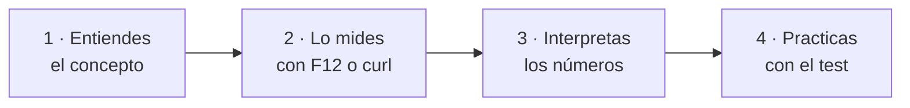

!!! tip "La terminal en Windows"
    Los comandos son de Linux. En Windows, ábrelos en **Git Bash** (viene con Git) o en **WSL**. En Linux y macOS, en la terminal normal.

---

## 1. Teoría paso a paso

### 1.1 Tus ODS como desarrollador

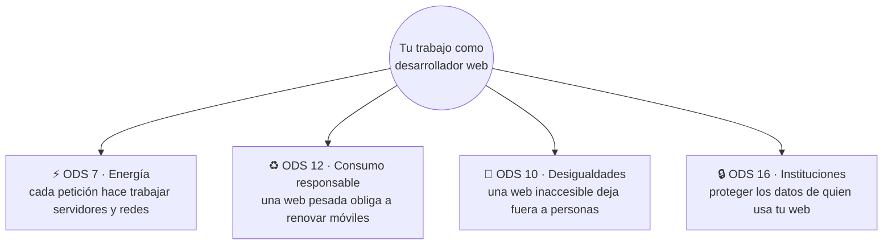

### 1.2 Qué pasa cuando abres una web

Una página no es un fichero: son **muchas peticiones**. Cada una viaja por la red, hace trabajar a un servidor y gasta batería en el móvil.

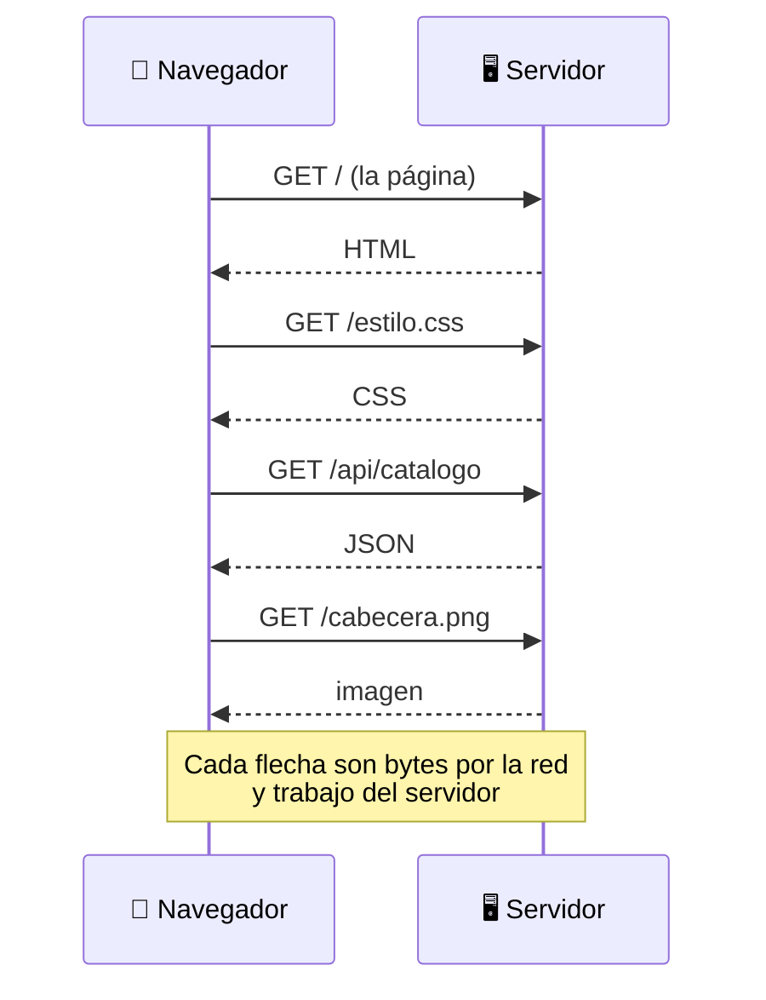

**Menos bytes = menos energía**: menos red, menos servidor, menos batería y móviles que duran más.

### 1.3 ¿Qué pesa en una página?

Esta es una tienda online real medida con F12. Casi todo el peso está en **dos** recursos:

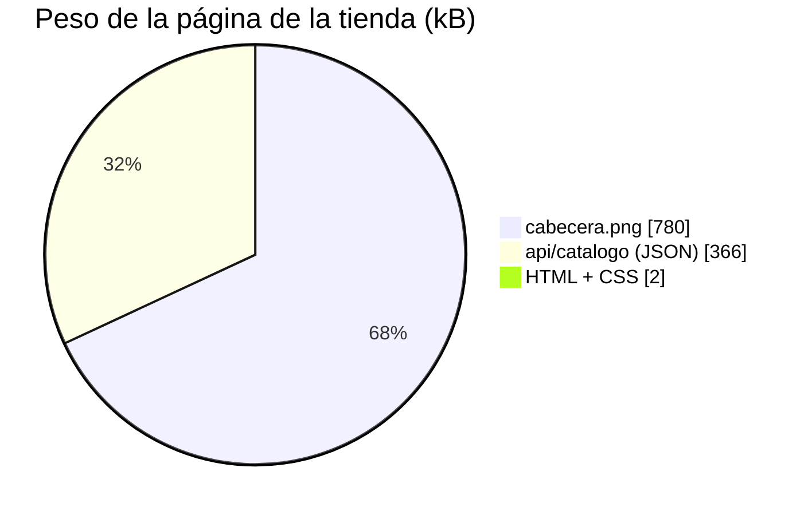

La lección: **antes de optimizar, mide**. Arreglar el HTML y el CSS (2 kB) no cambia nada si la imagen pesa 780 kB.

### 1.4 Las cuatro palancas de una web sostenible

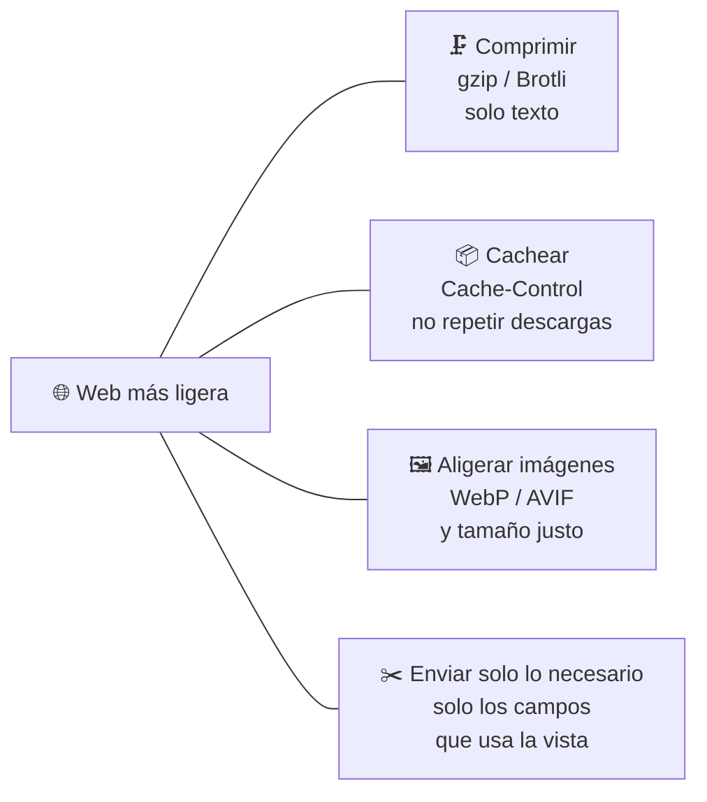

| Palanca | Qué ahorra | Cómo se activa |
|---|---|---|
| **Comprimir** | Bytes de texto: HTML, CSS, JS, JSON. En JSON, a menudo más del 90 % | Una línea de configuración del servidor |
| **Cachear** | Descargas repetidas del mismo fichero | Cabecera `Cache-Control: max-age=…` |
| **Aligerar imágenes** | Suelen ser lo que más pesa | Formatos WebP o AVIF y no servir una foto de 4000 px para un hueco de 400 |
| **Enviar solo lo necesario** | Bytes **y** datos personales que no hacían falta | Que la API devuelva solo lo que la pantalla usa |

### 1.5 Comprimir: solo funciona con texto

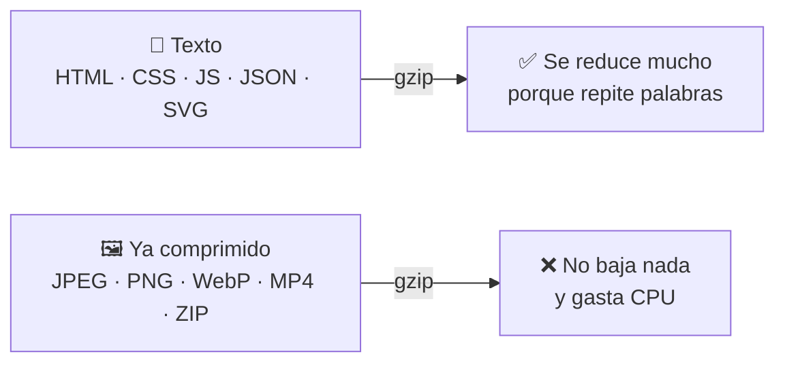

Un texto repite muchísimo (las mismas etiquetas, las mismas claves de JSON), y la compresión se aprovecha de eso. Una foto JPEG **ya viene comprimida**: volver a comprimirla no ahorra nada.

**Las cabeceras que lo cuentan:**

| Cabecera | Quién la envía | Qué dice |
|---|---|---|
| `Accept-Encoding: gzip, br` | El **navegador** | «Entiendo estos formatos comprimidos» |
| `Content-Encoding: gzip` | El **servidor** | «Te lo envío comprimido con gzip» |
| `Content-Type: text/css` | El **servidor** | «Esto es un CSS» |

### 1.6 Cachear: no descargar dos veces lo mismo

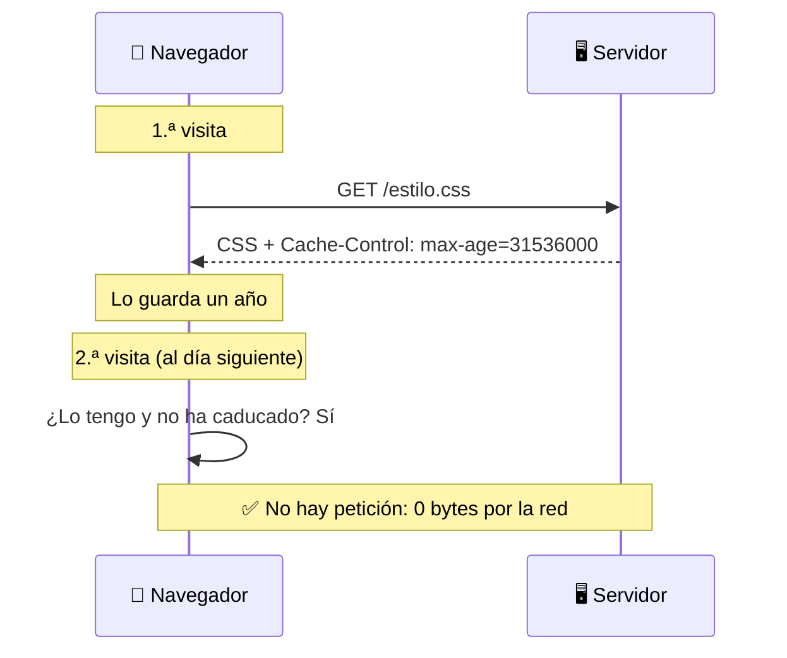

| `Cache-Control` | Qué significa |
|---|---|
| `max-age=31536000` | Puede reutilizarse durante **un año** (31 536 000 segundos) |
| `max-age=3600` | Durante **una hora** |
| `no-store` | **Prohibido** guardarlo. Gana a cualquier `max-age` que venga con él |
| `no-cache` | Hay que preguntar al servidor antes de reutilizarlo |
| *(no viene)* | El navegador no tiene instrucciones: a efectos prácticos, sin caché |

### 1.7 Accesibilidad y privacidad también son sostenibilidad

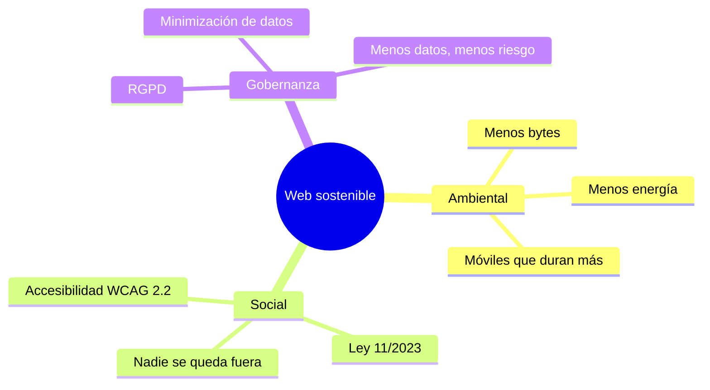

- **Accesibilidad:** las pautas **WCAG 2.2** del W3C dicen cómo hacer una web usable por todas las personas. Desde el **28 de junio de 2025** son exigibles a muchos servicios digitales dirigidos a consumidores (**Ley 11/2023**).
- **Privacidad:** el RGPD pide **minimización de datos**: tratar solo los datos necesarios. Menos datos es menos riesgo **y** menos bytes.

### 1.8 Y tu vida cuenta: ir a trabajar

Ir a trabajar es una de las mayores fuentes de emisiones directas de mucha gente.

| Medio | kg CO₂ por km y persona |
|---|---:|
| 🚗 Coche | 0,16 |
| 🏍️ Moto | 0,10 |
| 🚌 Autobús | 0,08 |
| 🚇 Metro / tren | 0,03 |
| 🚲 Bici / a pie | 0,00 |

```text
kg al año = factor × km de ida × 2 × días por semana × semanas
                                 ↑
                             ¡la vuelta!
```

### Resumen de la unidad

| Concepto | Cómo se mide | Herramienta |
|---|---|---|
| Peso de una página | Total transferido | F12 → Red |
| ¿Viene comprimido? | `Content-Encoding` | `curl -I` |
| Cuánto ahorra comprimir | Bytes antes y después | `curl -w`, `gzip`, `ls -l` |
| Caché | `Cache-Control` | `curl -I`, F12 |
| Accesibilidad | Informe de accesibilidad | F12 → Lighthouse |
| Datos innecesarios | Bytes de cada respuesta | `wc -c` |
| Huella del desplazamiento | factor × km × 2 × días × semanas | `bc` |

---

## 2. Prácticas guiadas

> Nueve prácticas cortas, **todas resueltas**. Primero hazlas tú en tu ordenador y luego compara con la salida y la explicación. Tus números pueden variar un poco: las webs cambian.

### Práctica 1 · Mira cuánto pesa una página

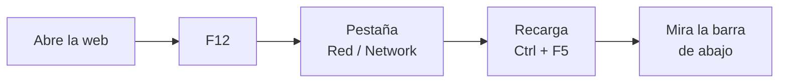

**Haz esto** con `https://pypi.org`:

1. Pulsa **F12** y ve a la pestaña **Red** (*Network*).
2. Recarga con **Ctrl + F5** (recarga sin usar la caché).
3. Mira la barra de abajo del todo.

??? success "Qué vas a ver y qué significa"

    Algo parecido a esto (los números exactos cambian cada vez):

    ```text
    32 solicitudes │ 180 kB transferidos │ 620 kB recursos │ Finalizado: 1,2 s
    ```

    | Dato | Qué significa |
    |---|---|
    | **solicitudes** | Cuántas peticiones ha hecho el navegador: cada una es un viaje por la red |
    | **transferidos** | Lo que ha viajado de verdad por la red (ya comprimido) |
    | **recursos** | Lo que ocupa todo una vez descomprimido en tu ordenador |

    Si **transferidos** es mucho menor que **recursos**, la web **comprime bien**.

    Pulsa en los filtros (**Doc**, **CSS**, **JS**, **Img**…) para ver qué tipo de recurso pesa más. Casi siempre ganan las imágenes o el JavaScript.

---

### Práctica 2 · Lee las cabeceras con `curl`

`curl -I` pide **solo las cabeceras**, sin descargar el contenido.

```bash
curl -sI -H "Accept-Encoding: gzip" https://pypi.org/
```

| Parte del comando | Qué hace |
|---|---|
| `-s` | Modo silencioso: sin barra de progreso |
| `-I` | Solo las cabeceras |
| `-H "Accept-Encoding: gzip"` | Dice al servidor que entendemos gzip, como hace un navegador |

??? success "Salida (resumida) y qué significa"

    ```text
    HTTP/2 200
    content-type: text/html; charset=UTF-8
    content-encoding: gzip
    content-length: 5938
    ```

    | Cabecera | Qué te dice |
    |---|---|
    | `HTTP/2 200` | La petición ha ido bien |
    | `content-type: text/html` | Es una página HTML: **texto**, así que debe comprimirse |
    | `content-encoding: gzip` | ✅ Viene comprimida |
    | `content-length: 5938` | Ocupa 5938 bytes por la red |
    | *(no hay `cache-control`)* | El HTML no se cachea. Es normal: la portada cambia a menudo |

    Para ver solo lo que te interesa, filtra con `grep -i` (la `-i` ignora mayúsculas):

    ```bash
    curl -sI -H "Accept-Encoding: gzip" https://pypi.org/ | grep -i "content-type\|content-encoding\|cache-control"
    ```

---

### Práctica 3 · ¿Cuánto ahorra comprimir?

Pide la misma página **dos veces**: sin compresión y con compresión. La opción `-w "%{size_download}"` escribe los bytes descargados y `-o /dev/null` tira el contenido (no lo necesitas).

```bash
curl -s -o /dev/null -w "%{size_download}\n" https://pypi.org/
curl -s -H "Accept-Encoding: gzip" -o /dev/null -w "%{size_download}\n" https://pypi.org/
```

??? success "Salida y cálculo"

    ```text
    27885
    5938
    ```

    ```text
    reducción = (antes − después) ÷ antes × 100
              = (27 885 − 5 938) ÷ 27 885 × 100  =  78,7 %
    ```

    ```text
    Sin comprimir  ████████████████████████████████████████  27,9 kB
    Comprimido     █████████░░░░░░░░░░░░░░░░░░░░░░░░░░░░░░░   5,9 kB
    ```

    Con una hoja de estilos de la misma web el resultado fue **115 485 → 19 094 bytes: un 83,5 % menos**.

    Todo eso lo consigue **una línea de configuración del servidor**. Multiplica por todas las visitas del año.

---

### Práctica 4 · Comprime tú: texto frente a «foto»

Vas a crear dos ficheros y comprimirlos con `gzip`:

- **`catalogo.json`**: un JSON de 2000 productos, muy repetitivo, como la respuesta de una API.
- **`foto.bin`**: 100 000 bytes al azar. Se comporta como un JPEG: los datos ya comprimidos parecen aleatorios.

```bash
for i in $(seq 1 2000); do
  echo "{\"id\": $i, \"nombre\": \"Producto de ejemplo\", \"precio\": 9.99, \"stock\": true},"
done > catalogo.json

head -c 100000 /dev/urandom > foto.bin

gzip -k catalogo.json        # -k: conserva el original
gzip -k foto.bin
ls -l catalogo.json* foto.bin*
```

??? success "Salida y qué significa"

    ```text
    154893  catalogo.json
      5525  catalogo.json.gz
    100000  foto.bin
    100047  foto.bin.gz
    ```

    | Fichero | Antes | Después | Reducción |
    |---|---:|---:|---:|
    | JSON (texto) | 154 893 | 5 525 | **96,4 %** |
    | «Foto» (datos ya comprimidos) | 100 000 | 100 047 | **¡crece 47 bytes!** |

    ```mermaid
    xychart-beta
        title "Bytes antes y después de gzip"
        x-axis ["JSON antes", "JSON gzip", "Foto antes", "Foto gzip"]
        y-axis "bytes" 0 --> 160000
        bar [154893, 5525, 100000, 100047]
    ```

    **La conclusión de la unidad:** se comprime **solo el texto**. Comprimir una imagen gasta CPU y no ahorra nada; incluso puede hacerla un poco más grande.

---

### Práctica 5 · ¿Se cachea?

```bash
curl -sI https://pypi.org/static/css/warehouse-ltr.eeaed0b2.css | grep -i cache-control
```

El nombre del CSS cambia con cada versión de la web. Si falla, búscalo en F12 → Red → filtro **CSS** y copia su dirección.

??? success "Salida y qué significa"

    ```text
    cache-control: max-age=315360000, public, immutable
    ```

    | Parte | Qué significa |
    |---|---|
    | `max-age=315360000` | Puede reutilizarse **10 años** (315 360 000 s ÷ 31 536 000 s/año) |
    | `public` | Lo pueden guardar también los servidores intermedios |
    | `immutable` | No va a cambiar nunca: ni siquiera hace falta preguntar |

    ¿Cómo actualizan entonces el CSS? **Cambiándole el nombre** (`eeaed0b2` es una huella del contenido). Si el fichero cambia, cambia el nombre, y el navegador lo descarga como uno nuevo.

    **Compruébalo en el navegador:** con F12 abierto en Red, recarga con **F5** normal. En la columna **Tamaño** de los CSS verás **(memoria caché)** o **(disco caché)**: 0 bytes por la red.

**Ejercicio rápido.** ¿Cuánto tiempo puede reutilizarse cada recurso?

| Cabecera | Respuesta |
|---|---|
| `public, max-age=31536000, immutable` | ? |
| `max-age=3600` | ? |
| `no-store, max-age=3600` | ? |
| *(no viene)* | ? |

??? success "Solución"

    | Cabecera | Respuesta |
    |---|---|
    | `public, max-age=31536000, immutable` | **1 año** |
    | `max-age=3600` | **1 hora** |
    | `no-store, max-age=3600` | **Nada**: `no-store` prohíbe guardarlo y gana al `max-age` |
    | *(no viene)* | **Nada**, a efectos prácticos |

---

### Práctica 6 · Audita una página con una ficha de puntos

Un auditor parte de **100 puntos** por recurso y resta:

| Problema | Resta |
|---|---:|
| Es texto y **no** viene comprimido | −30 |
| No tiene caché | −20 |
| Pesa más de 500 kB | −25 |

Esta es la tienda del apartado 1.3, medida con F12:

| Recurso | Tipo | Tamaño | ¿Comprimido? | Caché |
|---|---|---:|:-:|---|
| `/` | HTML | 1,2 kB | No | No |
| `/estilo.css` | CSS | 0,5 kB | No | No |
| `/api/catalogo` | JSON | 366 kB | No | No |
| `/cabecera.png` | PNG | 780 kB | No | 10 minutos |

**Haz esto:** pon nota a cada recurso y decide **qué arreglarías primero**.

??? success "Solución"

    | Recurso | Restas | Nota |
    |---|---|---:|
    | `/` | −30 (texto sin comprimir) −20 (sin caché) | **50** |
    | `/estilo.css` | −30 −20 | **50** |
    | `/api/catalogo` | −30 −20. No llega a 500 kB | **50** |
    | `/cabecera.png` | −25 (pesa más de 500 kB). **No** resta por compresión: un PNG no es texto | **75** |

    **La trampa:** la imagen saca **la mejor nota** y es **el 68 % del peso** de la página.

    ```mermaid
    quadrantChart
        title Nota frente a peso
        x-axis "Pesa poco" --> "Pesa mucho"
        y-axis "Nota baja" --> "Nota alta"
        quadrant-1 "Peligro oculto"
        quadrant-2 "Bien"
        quadrant-3 "Fácil de arreglar"
        quadrant-4 "Prioridad clara"
        "cabecera.png": [0.9, 0.75]
        "api/catalogo": [0.55, 0.5]
        "estilo.css": [0.05, 0.5]
        "HTML": [0.08, 0.5]
    ```

    **El orden correcto para arreglar:**

    1. **La imagen a WebP** y a su tamaño real: de 780 kB a unos 90 kB.
    2. **Comprimir el catálogo**: de 366 kB a unos 26 kB, con una línea de configuración.
    3. Después, la caché del HTML y del CSS.

    Resultado: de **1,1 MB a unos 120 kB**, una décima parte.

    **La lección:** una puntuación automática **orienta, no decide**. Sirve para encontrar problemas; para ordenarlos hay que mirar qué pesa de verdad.

---

### Práctica 7 · Pasa un análisis de accesibilidad

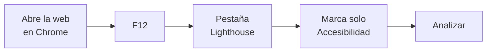

Lighthouse da una nota de 0 a 100 y la lista de fallos. Completa además estas **cinco comprobaciones a mano**, que no necesitan ninguna herramienta:

| Comprobación | Cómo se hace | Qué debería pasar |
|---|---|---|
| ⌨️ Teclado | Recorre la página solo con **Tab** y **Enter** | Llegas a todo y ves dónde está el foco |
| 🖼️ Texto alternativo | F12 → inspecciona una imagen | Tiene `alt="…"` describiendo lo que muestra |
| 🎨 Contraste | Lighthouse lo marca | El texto se lee bien sobre su fondo |
| 🏷️ Formularios | Haz clic en el texto de una etiqueta | El cursor salta a su campo |
| 🔍 Zoom | **Ctrl +** hasta el 200 % | No se corta ni se solapa nada |

??? success "Qué hacer con el resultado"

    Una nota alta de Lighthouse **no garantiza** que la web sea accesible: solo comprueba lo que se puede medir automáticamente. Por eso las comprobaciones a mano son imprescindibles, sobre todo la del **teclado**: muchas personas no pueden usar un ratón.

    Recuerda por qué importa: desde el **28 de junio de 2025**, la Ley 11/2023 exige accesibilidad a muchos servicios digitales para consumidores.

---

### Práctica 8 · Envía solo lo necesario

La pantalla de «Mis pedidos» solo muestra el **nombre** del cliente. Compara lo que devuelve la API con lo que de verdad hace falta:

```bash
echo '{"id":1,"nombre":"Ana García","email":"ana@correo.es","telefono":"600123456","dni":"12345678Z","direccion":"Calle Mayor 1, Alcalá","fechaNacimiento":"1999-04-12","ultimoAcceso":"2026-11-08T10:15:00"}' > completo.json
echo '{"id":1,"nombre":"Ana García"}' > necesario.json
wc -c completo.json necesario.json
```

??? success "Salida y qué significa"

    ```text
    202 completo.json
     32 necesario.json
    ```

    ```text
    completo.json   ████████████████████████████████████████  202 bytes
    necesario.json  ██████░░░░░░░░░░░░░░░░░░░░░░░░░░░░░░░░░░   32 bytes
    ```

    **84 % menos bytes** en cada petición. Pero lo importante es otra cosa: la respuesta completa enviaba **DNI, teléfono, dirección y fecha de nacimiento** que nadie iba a usar. Si esa respuesta se filtra, el daño es mucho mayor.

    Es la **minimización de datos** del RGPD: un solo cambio mejora a la vez lo **ambiental** (bytes) y la **gobernanza** (privacidad).

---

### Práctica 9 · La huella de ir a clase o a trabajar

`bc` es una calculadora de terminal. Alguien vive a **12 km**, va **5 días** a la semana durante **42 semanas**:

```bash
echo "0.16 * 12 * 2 * 5 * 42" | bc     # coche
echo "0.08 * 12 * 2 * 5 * 42" | bc     # autobús
```

??? success "Salida y qué significa"

    ```text
    806.40
    403.20
    ```

    ```mermaid
    xychart-beta
        title "kg de CO₂ al año · 12 km · 5 días · 42 semanas"
        x-axis ["Coche", "Moto", "Autobús", "Metro", "Bici"]
        y-axis "kg al año" 0 --> 900
        bar [806.4, 504, 403.2, 151.2, 0]
    ```

    - **Pasar del coche al autobús ahorra 403,2 kg al año**, la mitad.
    - El fallo típico es olvidar el **× 2** de la vuelta: sale justo la mitad, y en un informe real eso lo invalida.

    **Ahora tú:** cambia los números por tu trayecto real y calcula tu propia huella.

---

## 3. Simulacro de examen

> **Esta es la evaluación de la unidad.** Como la UT3 no usa Java, el simulacro es **solo un test de 30 preguntas**, y **las preguntas de RA3 del examen del trimestre salen de aquí**.

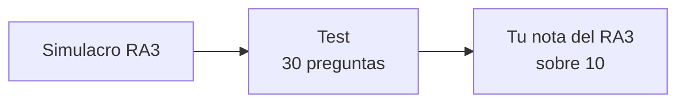

Hazlo **en 30 minutos**, sin mirar los apuntes. Tápate las respuestas, apunta las tuyas y corrige al final. Son preguntas **sencillas**: si has entendido la teoría y has hecho las prácticas, salen solas.

#### A · Conceptos

**1.** ¿Por qué una web más ligera es más sostenible?

a) porque se ve más bonita · b) porque ocupa menos en el disco del programador · c) porque gasta menos red, menos servidor y menos batería · d) no tiene relación con la sostenibilidad

??? success "Respuesta"

    **c**. Menos bytes = menos energía en todo el camino.

**2.** Hacer una web inaccesible para personas con discapacidad va contra el…

a) ODS 10 · b) ODS 7 · c) ODS 13 · d) ODS 12

??? success "Respuesta"

    **a**. Reducción de las desigualdades.

**3.** Una web tan pesada que obliga a cambiar de móvil para usarla va contra el…

a) ODS 10 · b) ODS 16 · c) ODS 7 · d) ODS 12

??? success "Respuesta"

    **d**. Consumo y producción responsables.

**4.** ¿Qué tipo de fichero **no** conviene comprimir con gzip?

a) un CSS · b) una imagen JPEG · c) un JSON · d) un HTML

??? success "Respuesta"

    **b**. Ya viene comprimida: no ahorra nada y gasta CPU.

**5.** ¿Por qué un JSON se comprime tanto?

a) porque es pequeño · b) porque es binario · c) porque repite muchas veces las mismas claves y palabras · d) porque lo comprime el navegador

??? success "Respuesta"

    **c**. La compresión aprovecha las repeticiones.

**6.** La cabecera con la que el **servidor** indica que envía la respuesta comprimida es…

a) Content-Encoding · b) Accept-Encoding · c) Content-Type · d) Cache-Control

??? success "Respuesta"

    **a**. Accept-Encoding la envía el navegador.

**7.** La cabecera con la que el **navegador** dice qué compresiones entiende es…

a) Content-Encoding · b) Content-Length · c) Cache-Control · d) Accept-Encoding

??? success "Respuesta"

    **d**. Por ejemplo: Accept-Encoding: gzip, br.

**8.** ¿Qué cabecera dice durante cuánto tiempo puede reutilizarse un recurso?

a) Content-Type · b) Cache-Control · c) Content-Encoding · d) Accept-Encoding

??? success "Respuesta"

    **b**. Con la directiva max-age.

**9.** ¿Qué formatos de imagen se recomiendan para aligerar una web?

a) BMP y TIFF · b) PNG y GIF siempre · c) WebP y AVIF · d) ninguno: las imágenes no pesan

??? success "Respuesta"

    **c**. Pesan mucho menos con la misma calidad visible.

**10.** Las pautas de accesibilidad web del W3C se llaman…

a) WCAG · b) RGPD · c) ODS · d) HTTP

??? success "Respuesta"

    **a**. Versión actual: WCAG 2.2.

**11.** Desde el 28 de junio de 2025 la accesibilidad es exigible a muchos servicios digitales para consumidores por la…

a) Agenda 2030 · b) Ley de Cookies · c) Directiva de Ecodiseño · d) Ley 11/2023

??? success "Respuesta"

    **d**. Ley 11/2023.

**12.** El principio del RGPD de tratar solo los datos necesarios se llama…

a) portabilidad · b) minimización de datos · c) exactitud · d) anonimato

??? success "Respuesta"

    **b**. Menos datos: menos riesgo y menos bytes.

#### B · Las herramientas

**13.** Para ver el peso de una página en el navegador se usa…

a) F5 → Ajustes · b) Ctrl + P · c) F12 → pestaña Red · d) el administrador de tareas

??? success "Respuesta"

    **c**. Y se recarga con Ctrl + F5 para no usar la caché.

**14.** En la pestaña Red, «transferidos» mucho menor que «recursos» indica que…

a) la web comprime bien · b) la web está rota · c) no hay caché · d) hay demasiadas imágenes

??? success "Respuesta"

    **a**. Transferidos es lo que viaja comprimido; recursos, lo descomprimido.

**15.** ¿Qué hace `curl -I`?

a) descarga las imágenes · b) instala curl · c) comprime un fichero · d) pide solo las cabeceras de la respuesta

??? success "Respuesta"

    **d**. Sin descargar el contenido.

**16.** En `curl -s -o /dev/null -w "%{size_download}" URL`, ¿qué muestra el comando?

a) el código HTML · b) los bytes descargados · c) las cabeceras · d) el tiempo de carga

??? success "Respuesta"

    **b**. -o /dev/null tira el contenido y -w escribe el tamaño.

**17.** ¿Para qué sirve `gzip -k catalogo.json`?

a) borra el fichero · b) descomprime el fichero · c) comprime el fichero y conserva el original · d) cuenta las líneas

??? success "Respuesta"

    **c**. -k significa keep: conservar.

**18.** ¿Qué comando cuenta los bytes de un fichero?

a) wc -c · b) ls -d · c) gzip -k · d) curl -I

??? success "Respuesta"

    **a**. c de caracteres (bytes).

**19.** ¿Dónde se pasa un análisis de accesibilidad automático en Chrome?

a) F12 → Consola · b) Ctrl + F5 · c) Configuración → Privacidad · d) F12 → Lighthouse

??? success "Respuesta"

    **d**. Marcando solo la categoría Accesibilidad.

#### C · Calcular e interpretar

**20.** Una página pasa de 27 885 bytes a 5 938 al comprimirla. La reducción es de aproximadamente…

a) 21 % · b) 79 % · c) 5 % · d) 95 %

??? success "Respuesta"

    **b**. (27 885 − 5 938) ÷ 27 885 × 100 = 78,7 %.

**21.** Al comprimir con gzip un fichero de datos aleatorios (como un JPEG) de 100 000 bytes, ocupa…

a) la mitad · b) un 10 % · c) casi lo mismo o algo más · d) 0 bytes

??? success "Respuesta"

    **c**. En la práctica 4 creció a 100 047 bytes.

**22.** `Cache-Control: max-age=3600` significa que el recurso puede reutilizarse…

a) una hora · b) un día · c) un año · d) nunca

??? success "Respuesta"

    **a**. 3600 segundos.

**23.** `Cache-Control: no-store, max-age=3600` significa que…

a) se guarda una hora · b) se guarda un año · c) es un error del servidor · d) no se puede guardar: no-store gana

??? success "Respuesta"

    **d**. no-store prohíbe guardarlo.

**24.** ¿Cómo se actualiza un CSS que tiene caché de 10 años e `immutable`?

a) esperando 10 años · b) cambiándole el nombre al fichero · c) borrando la caché de cada usuario · d) no se puede actualizar

??? success "Respuesta"

    **b**. La huella del nombre cambia con el contenido.

**25.** Con la ficha de puntos (−30 texto sin comprimir, −20 sin caché, −25 más de 500 kB), un JSON de 366 kB sin comprimir ni caché saca…

a) 25 · b) 75 · c) 50 · d) 100

??? success "Respuesta"

    **c**. 100 − 30 − 20. No pasa de 500 kB.

**26.** Con la misma ficha, un PNG de 780 kB con caché saca…

a) 75 · b) 25 · c) 50 · d) 45

??? success "Respuesta"

    **a**. Solo resta por peso: un PNG no es texto.

**27.** En la tienda de la práctica 6, ¿qué conviene arreglar **primero**?

a) el CSS de 0,5 kB · b) el HTML de 1,2 kB · c) nada: la nota media es buena · d) la imagen de 780 kB

??? success "Respuesta"

    **d**. Es el 68 % del peso, aunque tenga la mejor nota.

**28.** Una API devuelve 202 bytes por cliente cuando la pantalla solo necesita 32. Recortarla mejora…

a) solo la privacidad · b) los bytes y la privacidad a la vez · c) solo los bytes · d) nada

??? success "Respuesta"

    **b**. Minimización de datos: ambiental y gobernanza.

**29.** 12 km de ida en coche (0,16 kg/km), 5 días, 42 semanas emiten al año…

a) 403,2 kg · b) 100,8 kg · c) 806,4 kg · d) 1612,8 kg

??? success "Respuesta"

    **c**. 0,16 × 12 × 2 × 5 × 42. 403,2 sería olvidar la vuelta.

**30.** Ese mismo trayecto en autobús (0,08 kg/km) ahorra frente al coche…

a) 403,2 kg · b) 806,4 kg · c) 0 kg · d) 201,6 kg

??? success "Respuesta"

    **a**. El autobús emite la mitad: 403,2 kg.

### Tu nota del simulacro

```text
nota RA3 = aciertos ÷ 30 × 10
```

Si sale por debajo de 5, repite las prácticas de la unidad antes del examen del trimestre.
