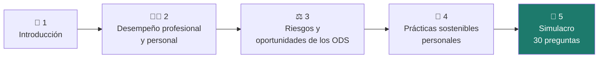
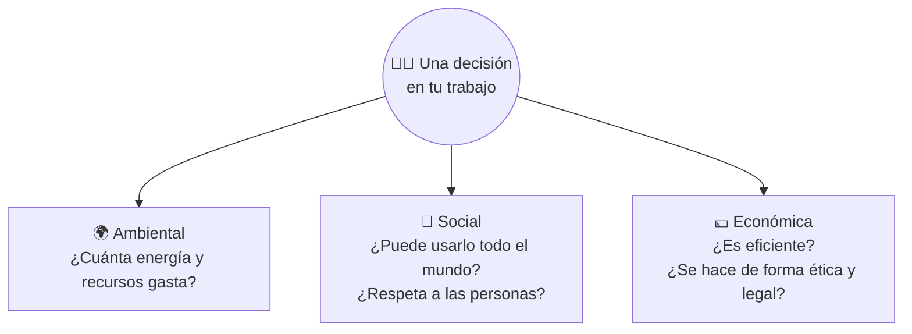
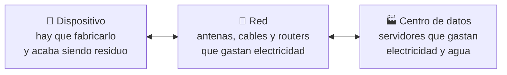
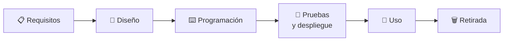
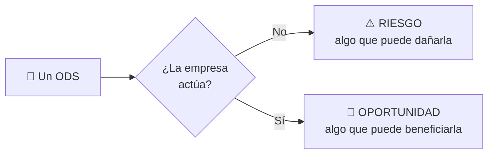
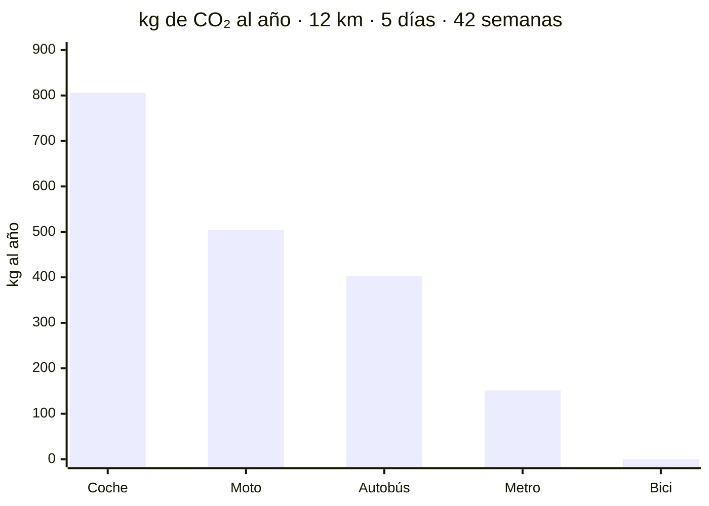
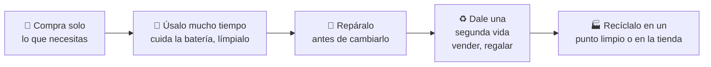
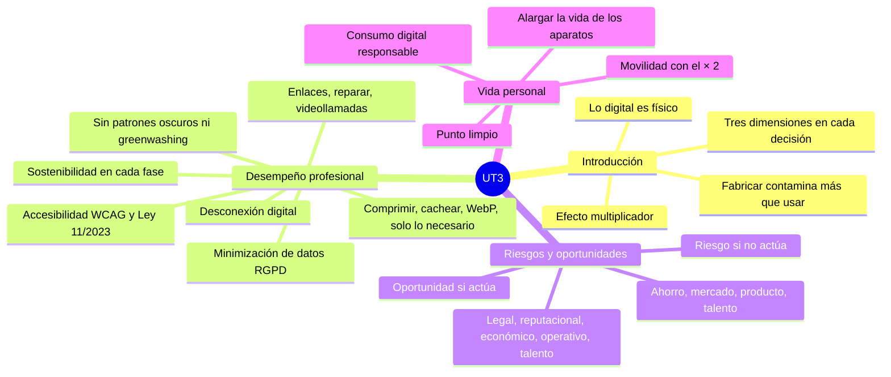

# UT3 · Sostenibilidad en el desempeño profesional y personal

> **RA3** · 4 h · 15 % · **Sin Java**: es una unidad de **lectura con actividades autocorregibles**

!!! info "Cómo trabajar esta unidad tú solo"
    1. **Lee** cada apartado. Son textos cortos, con esquemas y tablas.
    2. Al final de cada apartado hay una **actividad**: pulsa la respuesta que creas correcta y verás al momento si aciertas y **por qué**.
    3. Cuando acabes los cuatro apartados, haz el **simulacro**: 30 preguntas con tu nota al final. **Las preguntas de RA3 del examen salen de ahí.**

    Todo lo que se pregunta está en el texto. Si fallas, vuelve a leer el apartado.



| Apartado | Tiempo aproximado | Actividad |
|---|:-:|---|
| 1 · Introducción | 25 min | 4 preguntas |
| 2 · Desempeño profesional y personal | 75 min | 8 preguntas |
| 3 · Riesgos y oportunidades de los ODS | 60 min | 6 preguntas |
| 4 · Prácticas sostenibles personales | 40 min | 4 preguntas y autodiagnóstico |
| 5 · Simulacro | 40 min | 30 preguntas con nota |

---

## 1. Introducción

### 1.1 ¿Qué es trabajar de forma sostenible?

Trabajar de forma sostenible es **tener en cuenta en cada decisión su impacto ambiental, social y económico**: las tres dimensiones que viste en la UT1.



### 1.2 Lo digital no es «inmaterial»

Solemos decir que las cosas están «en la nube», como si no ocuparan nada. Pero la nube es **física**:



Un dato clave: **en un móvil o un portátil, fabricar el aparato suele contaminar más que todos sus años de uso**. Por eso alargar la vida de los dispositivos es una de las medidas más eficaces.

### 1.3 ¿Por qué te toca a ti, que desarrollas aplicaciones?

| Razón | Qué significa |
|---|---|
| **Tú decides cómo se construye** | El peso de una web, los datos que pide o si es accesible dependen de tus decisiones |
| **El efecto multiplicador** | Lo que haces se repite en cada visita. Una mejora pequeña, multiplicada por millones de usos, es enorme |
| **La ley y los clientes lo piden** | Accesibilidad, protección de datos, información sobre sostenibilidad… |

!!! example "El efecto multiplicador en números"
    Quitas **1 MB** innecesario de una página que se visita **1 millón de veces al mes**:

    `1 MB × 1 000 000 = 1 000 000 MB =` **1 TB menos al mes** viajando por la red.

### ✍️ Actividad 1 · Comprueba lo que has leído

<div class="quiz" data-correcta="a" data-grupo="act1">
<p class="quiz-enunciado">Lo digital es «inmaterial»: una app no gasta recursos porque está en la nube.</p>
<button class="quiz-op" data-op="a">a) Falso</button>
<button class="quiz-op" data-op="b">b) Verdadero</button>
<p class="quiz-expl"><span class="quiz-veredicto"></span>Respuesta correcta: <strong>a</strong>. La nube son centros de datos que gastan electricidad y agua, redes y dispositivos que hay que fabricar.</p>
</div>

<div class="quiz" data-correcta="a" data-grupo="act1">
<p class="quiz-enunciado">En un móvil o un portátil, fabricar el aparato suele contaminar más que todos sus años de uso.</p>
<button class="quiz-op" data-op="a">a) Verdadero</button>
<button class="quiz-op" data-op="b">b) Falso</button>
<p class="quiz-expl"><span class="quiz-veredicto"></span>Respuesta correcta: <strong>a</strong>. Por eso alargar la vida de los dispositivos es de lo más eficaz.</p>
</div>

<div class="quiz" data-correcta="d" data-grupo="act1">
<p class="quiz-enunciado">Ahorras 1 MB en una página que se visita 1 millón de veces al mes. ¿Cuánto se deja de transmitir al mes?</p>
<button class="quiz-op" data-op="a">a) 1 MB</button>
<button class="quiz-op" data-op="b">b) 1 GB</button>
<button class="quiz-op" data-op="c">c) 1 kB</button>
<button class="quiz-op" data-op="d">d) 1 TB</button>
<p class="quiz-expl"><span class="quiz-veredicto"></span>Respuesta correcta: <strong>d</strong>. 1 MB × 1 000 000 = 1 000 000 MB = 1 TB. Es el efecto multiplicador.</p>
</div>

<div class="quiz" data-correcta="b" data-grupo="act1">
<p class="quiz-enunciado">Actuar de forma sostenible en el trabajo significa tener en cuenta en cada decisión…</p>
<button class="quiz-op" data-op="a">a) solo el ahorro de dinero</button>
<button class="quiz-op" data-op="b">b) el impacto ambiental, social y económico</button>
<button class="quiz-op" data-op="c">c) solo el medio ambiente</button>
<button class="quiz-op" data-op="d">d) solo lo que diga el jefe</button>
<p class="quiz-expl"><span class="quiz-veredicto"></span>Respuesta correcta: <strong>b</strong>. Son las tres dimensiones que viste en la UT1.</p>
</div>

---

## 2. Desempeño profesional y personal

Tu desempeño tiene **dos caras**: lo que haces **en tu trabajo** (profesional) y lo que haces **en tu vida** (personal). Este apartado va de la primera; el apartado 4, de la segunda.

### 2.1 La sostenibilidad en cada fase del desarrollo de una aplicación

Una aplicación pasa por varias fases. **En todas** se pueden tomar decisiones sostenibles:



| Fase | La pregunta sostenible | Ejemplo de buena práctica |
|---|---|---|
| 📋 **Requisitos** | ¿Hace falta esta función? ¿Qué datos necesito **de verdad**? | No pedir el DNI ni la fecha de nacimiento si no se van a usar |
| 🎨 **Diseño** | ¿Puede usarla todo el mundo? ¿Funciona en móviles antiguos y con mala conexión? | Diseño accesible y ligero |
| ⌨️ **Programación** | ¿Envío solo lo necesario? ¿Pesa lo mínimo? | Imágenes en WebP, comprimir el texto, usar la caché |
| 🚀 **Pruebas y despliegue** | ¿Hay algo encendido que nadie usa? | **Apagar los entornos de pruebas** cuando no se usan |
| 👥 **Uso** | ¿Sé cuánto pesa y cuánto consume? | Medir y mejorar con cada versión |
| 🗑️ **Retirada** | ¿Qué queda cuando la app se cierra? | **Borrar los datos** que ya no se necesitan y **apagar sus servidores** |

### 2.2 Cuatro formas de que una web pese menos

Pulsa en cada pestaña:

=== "🗜️ Comprimir"

    El servidor envía el **texto** comprimido y el navegador lo descomprime. Se ahorra muchísimo, sobre todo en JSON.

    | Se comprime bien | No merece la pena |
    |---|---|
    | HTML, CSS, JavaScript, JSON | Fotos JPEG, vídeos MP4, ficheros ZIP: **ya vienen comprimidos** |

=== "📦 Cachear"

    La **caché** permite que el navegador **guarde un fichero y no lo descargue otra vez** en la siguiente visita. El logo o la hoja de estilos se bajan una vez y se reutilizan.

=== "🖼️ Aligerar imágenes"

    Las imágenes suelen ser **lo que más pesa**. Dos reglas:

    - Usar formatos modernos como **WebP**, que pesan menos con la misma calidad visible.
    - No enviar una foto de 4000 píxeles para mostrarla en un hueco de 400.

=== "✂️ Enviar solo lo necesario"

    Si una pantalla solo muestra el nombre del cliente, la aplicación no debería enviar también su DNI, teléfono y dirección. Se ahorran bytes **y** se protegen datos personales.

### 2.3 Lo social y la gobernanza también son tu trabajo

| Tema | Qué es | Qué norma o idea |
|---|---|---|
| ♿ **Accesibilidad** | Que la app la pueda usar **todo el mundo**, también personas con discapacidad (por ejemplo, solo con teclado o con lector de pantalla) | Pautas **WCAG**. En España, la **Ley 11/2023** la exige a muchos servicios digitales desde el **28 de junio de 2025** |
| 🔒 **Privacidad** | Tratar los datos personales con cuidado | El RGPD pide **minimización de datos**: solo los imprescindibles |
| ⚖️ **Ética** | No engañar a quien usa tu app | Evitar los **patrones oscuros**: diseños que empujan al usuario a hacer algo que no quiere (casillas ya marcadas, botón de «cancelar» escondido…) |
| 🔍 **Transparencia** | No presumir de lo que no se hace | Nada de **greenwashing**: cada afirmación, con datos |

### 2.4 El uso de la tecnología en la empresa

No solo importa lo que programas: también **cómo se usa la tecnología cada día** en la oficina.

| Situación | ✅ Práctica sostenible | ❌ Práctica poco sostenible |
|---|---|---|
| 💻 Ordenadores y móviles | Alargar su vida, **repararlos**, comprar **reacondicionados** | Renovarlos todos cada año aunque funcionen |
| 📧 Ficheros por correo | Enviar un **enlace** al fichero compartido | Mandar un adjunto de 20 MB a 50 personas: **50 copias** guardadas |
| 🗄️ Almacenamiento | Borrar duplicados y lo que ya no sirve | Guardarlo todo «por si acaso» |
| 🤝 Reuniones | **Videollamada** cuando no hace falta viajar | Viajar a cada reunión |
| 🖥️ Servidores | Apagar los de pruebas fuera de horario | Dejarlos encendidos el fin de semana |
| 🏠 Teletrabajo | Algunos días en casa ahorran desplazamientos | — |

### 2.5 Tu desempeño personal dentro del trabajo

Ser un buen profesional sostenible también es cuidarte y cuidar al equipo:

- **Aprender siempre**: la tecnología cambia y la formación continua evita quedarse atrás.
- **Trabajar en equipo** y respetar la diversidad.
- **Cuidar tu salud**: pausas, postura y descanso.
- **Desconexión digital**: la **Ley Orgánica 3/2018 (artículo 88)** reconoce el derecho a **no responder mensajes de trabajo fuera de tu horario**.

### ✍️ Actividad 2 · Comprueba lo que has leído

<div class="quiz" data-correcta="c" data-grupo="act2">
<p class="quiz-enunciado">«Antes de pedir el DNI en un formulario, pregúntate si de verdad lo necesitas.» ¿En qué fase del desarrollo se decide?</p>
<button class="quiz-op" data-op="a">a) Pruebas y despliegue</button>
<button class="quiz-op" data-op="b">b) Retirada</button>
<button class="quiz-op" data-op="c">c) Requisitos</button>
<button class="quiz-op" data-op="d">d) Uso</button>
<p class="quiz-expl"><span class="quiz-veredicto"></span>Respuesta correcta: <strong>c</strong>. En los requisitos se decide qué datos hacen falta: minimización de datos.</p>
</div>

<div class="quiz" data-correcta="a" data-grupo="act2">
<p class="quiz-enunciado">Apagar por la noche los servidores de pruebas que nadie usa es una buena práctica de la fase de…</p>
<button class="quiz-op" data-op="a">a) pruebas y despliegue</button>
<button class="quiz-op" data-op="b">b) requisitos</button>
<button class="quiz-op" data-op="c">c) diseño</button>
<button class="quiz-op" data-op="d">d) retirada</button>
<p class="quiz-expl"><span class="quiz-veredicto"></span>Respuesta correcta: <strong>a</strong>. Los entornos de pruebas encendidos sin uso gastan energía y dinero.</p>
</div>

<div class="quiz" data-correcta="d" data-grupo="act2">
<p class="quiz-enunciado">Convertir las imágenes a WebP y comprimir el texto se hace sobre todo al…</p>
<button class="quiz-op" data-op="a">a) retirar la app</button>
<button class="quiz-op" data-op="b">b) definir requisitos</button>
<button class="quiz-op" data-op="c">c) hacer la reunión de equipo</button>
<button class="quiz-op" data-op="d">d) programar</button>
<p class="quiz-expl"><span class="quiz-veredicto"></span>Respuesta correcta: <strong>d</strong>. Son decisiones de programación que aligeran la web.</p>
</div>

<div class="quiz" data-correcta="b" data-grupo="act2">
<p class="quiz-enunciado">Borrar los datos de los usuarios de una app que se va a cerrar corresponde a la fase de…</p>
<button class="quiz-op" data-op="a">a) diseño</button>
<button class="quiz-op" data-op="b">b) retirada</button>
<button class="quiz-op" data-op="c">c) programación</button>
<button class="quiz-op" data-op="d">d) requisitos</button>
<p class="quiz-expl"><span class="quiz-veredicto"></span>Respuesta correcta: <strong>b</strong>. Al retirar una app hay que borrar lo que ya no se necesita y apagar sus servidores.</p>
</div>

<div class="quiz" data-correcta="c" data-grupo="act2">
<p class="quiz-enunciado">Diseñar una web que se pueda usar solo con teclado es una decisión de…</p>
<button class="quiz-op" data-op="a">a) caché</button>
<button class="quiz-op" data-op="b">b) compresión</button>
<button class="quiz-op" data-op="c">c) accesibilidad</button>
<button class="quiz-op" data-op="d">d) gobernanza económica</button>
<p class="quiz-expl"><span class="quiz-veredicto"></span>Respuesta correcta: <strong>c</strong>. Accesibilidad: que nadie se quede fuera (ODS 10).</p>
</div>

<div class="quiz" data-correcta="a" data-grupo="act2">
<p class="quiz-enunciado">Mandar el mismo adjunto de 20 MB a 50 personas, en lugar de un enlace al fichero compartido, es…</p>
<button class="quiz-op" data-op="a">a) poco sostenible: se guardan 50 copias</button>
<button class="quiz-op" data-op="b">b) lo más sostenible</button>
<button class="quiz-op" data-op="c">c) obligatorio por ley</button>
<button class="quiz-op" data-op="d">d) igual de sostenible</button>
<p class="quiz-expl"><span class="quiz-veredicto"></span>Respuesta correcta: <strong>a</strong>. Un enlace evita copias repetidas en los buzones y servidores.</p>
</div>

<div class="quiz" data-correcta="b" data-grupo="act2">
<p class="quiz-enunciado">Un diseño que engaña al usuario para que acepte algo que no quiere (un «patrón oscuro») es un problema ético.</p>
<button class="quiz-op" data-op="a">a) Falso</button>
<button class="quiz-op" data-op="b">b) Verdadero</button>
<p class="quiz-expl"><span class="quiz-veredicto"></span>Respuesta correcta: <strong>b</strong>. La ética y la transparencia forman parte de la gobernanza.</p>
</div>

<div class="quiz" data-correcta="b" data-grupo="act2">
<p class="quiz-enunciado">El derecho a la desconexión digital significa que la empresa puede escribirte a cualquier hora y debes contestar.</p>
<button class="quiz-op" data-op="a">a) Verdadero</button>
<button class="quiz-op" data-op="b">b) Falso</button>
<p class="quiz-expl"><span class="quiz-veredicto"></span>Respuesta correcta: <strong>b</strong>. Es al revés: tienes derecho a no responder fuera de tu horario (Ley Orgánica 3/2018, art. 88).</p>
</div>

---

## 3. Riesgos y oportunidades que representan los ODS

### 3.1 Riesgo y oportunidad

Los ODS (UT1) no son solo una lista de buenas intenciones: para una empresa pueden ser un **riesgo** o una **oportunidad**.



- Un **riesgo** es algo que **puede dañar a la empresa si no actúa**: multas, mala imagen, más costes, perder clientes.
- Una **oportunidad** es algo que **puede beneficiar a la empresa si actúa**: ahorrar, conseguir clientes, atraer talento, crear productos nuevos.

### 3.2 Tipos de riesgo

=== "⚖️ Legal"

    Incumplir una norma: multas por no proteger los datos (RGPD) o por no hacer accesible un servicio (Ley 11/2023).

=== "📰 Reputacional"

    Perder la confianza de clientes y sociedad: que se descubra un caso de **greenwashing** o que se filtren datos personales.

=== "💶 Económico"

    Más costes: si sube el precio de la electricidad, sube la factura de los servidores.

=== "⚙️ Operativo"

    Que el servicio deje de funcionar bien: por ejemplo, una **ola de calor** que obliga a apagar parte de un centro de datos.

=== "👥 Talento"

    Que los buenos profesionales no quieran trabajar allí o se vayan: muchas personas eligen empresa también por sus valores y condiciones.

### 3.3 Tipos de oportunidad

| Oportunidad | Ejemplo en una empresa de software |
|---|---|
| 💰 **Ahorro** | Código más eficiente → menos servidores → menos energía y menos factura |
| 🛒 **Mercado** | Concursos públicos y clientes que **exigen** apps accesibles o criterios ambientales: si ya los cumples, puedes ganar el contrato |
| 📱 **Producto** | Crear apps que ayuden a otros a ser sostenibles: controlar el consumo de luz, compartir coche, comprar y vender **de segunda mano**… |
| 🌟 **Talento y reputación** | Teletrabajo, horarios flexibles y valores claros atraen a buenos profesionales |

### 3.4 Los ODS en una empresa de desarrollo de software

| ODS | ⚠️ Riesgo si no actúa | 🚀 Oportunidad si actúa |
|---|---|---|
| **4** · Educación de calidad | La plantilla sin formación se queda atrás | Formación continua; apps educativas |
| **5** · Igualdad de género | Brecha salarial, equipos poco diversos | Equipos diversos que diseñan mejores productos |
| **7** · Energía asequible y no contaminante | Factura eléctrica cada vez más alta | Eficiencia y renovables; apps de control energético |
| **8** · Trabajo decente | Horarios abusivos, gente que se va | Teletrabajo y conciliación que atraen talento |
| **9** · Industria, innovación e infraestructura | Quedarse obsoleta | Digitalizar a otros sectores |
| **10** · Reducción de las desigualdades | Web inaccesible: sanciones y usuarios perdidos | Llegar a más personas |
| **12** · Producción y consumo responsables | Apps que obligan a cambiar de móvil; residuos electrónicos | Apps ligeras; plataformas de segunda mano y reparación |
| **13** · Acción por el clima | Olas de calor que afectan a los centros de datos; clientes que exigen datos de emisiones | Medir y reducir la huella; ofrecer servicios más limpios |
| **16** · Paz, justicia e instituciones sólidas | Filtraciones de datos, sanciones del RGPD | Confianza y transparencia |

### ✍️ Actividad 3 · ¿Riesgo u oportunidad?

<div class="quiz" data-correcta="c" data-grupo="act3">
<p class="quiz-enunciado">Una empresa de software no hace accesible su web y una ley se lo exige. Para ella eso es…</p>
<button class="quiz-op" data-op="a">a) una oportunidad de mercado</button>
<button class="quiz-op" data-op="b">b) un riesgo operativo</button>
<button class="quiz-op" data-op="c">c) un riesgo legal</button>
<button class="quiz-op" data-op="d">d) no tiene relación con los ODS</button>
<p class="quiz-expl"><span class="quiz-veredicto"></span>Respuesta correcta: <strong>c</strong>. Puede recibir sanciones y perder clientes. ODS 10.</p>
</div>

<div class="quiz" data-correcta="a" data-grupo="act3">
<p class="quiz-enunciado">Una empresa ofrece una app para que los comercios controlen su consumo de luz. Eso es…</p>
<button class="quiz-op" data-op="a">a) una oportunidad de producto</button>
<button class="quiz-op" data-op="b">b) un riesgo reputacional</button>
<button class="quiz-op" data-op="c">c) un riesgo legal</button>
<button class="quiz-op" data-op="d">d) greenwashing</button>
<p class="quiz-expl"><span class="quiz-veredicto"></span>Respuesta correcta: <strong>a</strong>. Crea un producto que ayuda a otros a ser sostenibles. ODS 7.</p>
</div>

<div class="quiz" data-correcta="d" data-grupo="act3">
<p class="quiz-enunciado">Una ola de calor obliga a apagar parte de un centro de datos. Es un riesgo…</p>
<button class="quiz-op" data-op="a">a) legal</button>
<button class="quiz-op" data-op="b">b) de talento</button>
<button class="quiz-op" data-op="c">c) reputacional</button>
<button class="quiz-op" data-op="d">d) operativo</button>
<p class="quiz-expl"><span class="quiz-veredicto"></span>Respuesta correcta: <strong>d</strong>. Afecta al funcionamiento del servicio. ODS 13.</p>
</div>

<div class="quiz" data-correcta="b" data-grupo="act3">
<p class="quiz-enunciado">Se filtran los datos personales de los clientes de una app. ¿Qué riesgos genera?</p>
<button class="quiz-op" data-op="a">a) solo económico</button>
<button class="quiz-op" data-op="b">b) legal y reputacional</button>
<button class="quiz-op" data-op="c">c) ninguno</button>
<button class="quiz-op" data-op="d">d) solo de talento</button>
<p class="quiz-expl"><span class="quiz-veredicto"></span>Respuesta correcta: <strong>b</strong>. Sanción del RGPD y pérdida de confianza. ODS 16.</p>
</div>

<div class="quiz" data-correcta="c" data-grupo="act3">
<p class="quiz-enunciado">Un concurso público exige que la aplicación sea accesible. La empresa que ya lo es tiene…</p>
<button class="quiz-op" data-op="a">a) un riesgo legal</button>
<button class="quiz-op" data-op="b">b) un riesgo operativo</button>
<button class="quiz-op" data-op="c">c) una oportunidad de mercado</button>
<button class="quiz-op" data-op="d">d) una obligación de cerrar</button>
<p class="quiz-expl"><span class="quiz-veredicto"></span>Respuesta correcta: <strong>c</strong>. Puede presentarse y ganar el contrato.</p>
</div>

<div class="quiz" data-correcta="a" data-grupo="act3">
<p class="quiz-enunciado">Una empresa ofrece teletrabajo y horarios flexibles y le cuesta menos contratar buenos profesionales. ¿Con qué ODS se relaciona?</p>
<button class="quiz-op" data-op="a">a) ODS 8 · Trabajo decente</button>
<button class="quiz-op" data-op="b">b) ODS 13 · Clima</button>
<button class="quiz-op" data-op="c">c) ODS 7 · Energía</button>
<button class="quiz-op" data-op="d">d) ODS 12 · Consumo responsable</button>
<p class="quiz-expl"><span class="quiz-veredicto"></span>Respuesta correcta: <strong>a</strong>. Trabajo decente y crecimiento económico.</p>
</div>

---

## 4. Prácticas sostenibles en el ambiente personal

Lo que haces fuera del trabajo también cuenta, y muchas de estas costumbres se llevan a la oficina.

### 4.1 Cómo vas a trabajar o a clase

Ir y volver cada día es una de las mayores fuentes de emisiones de mucha gente.

| Medio | kg de CO₂ por km y persona |
|---|---:|
| 🚗 Coche | 0,16 |
| 🏍️ Moto | 0,10 |
| 🚌 Autobús | 0,08 |
| 🚇 Metro / tren | 0,03 |
| 🚲 Bici / a pie | 0 |

```text
kg al año = factor × km de ida × 2 × días por semana × semanas
                                 ↑
                         ¡no olvides la vuelta!
```

!!! example "Ejemplo resuelto"
    12 km de ida, 5 días por semana, 42 semanas:

    - En **coche**: `0,16 × 12 × 2 × 5 × 42 =` **806,4 kg** al año.
    - En **autobús**: `0,08 × 12 × 2 × 5 × 42 =` **403,2 kg** al año. **La mitad.**

    Si olvidas el × 2, te sale justo la mitad de lo real.



### 4.2 Tus dispositivos



Un aparato electrónico **nunca va a la basura normal ni al contenedor amarillo** (ese es para envases). Tiene materiales valiosos y otros contaminantes. Recuerda de la UT2: en 2022 solo se recogió de forma correcta **el 22,3 %** de los residuos electrónicos del mundo.

### 4.3 Tu consumo digital

| Hábito | Por qué ayuda |
|---|---|
| Ver series y vídeos en la **calidad que tu pantalla aprovecha** | En un móvil, la calidad máxima no se nota y gasta más datos y energía |
| **Descargar** lo que vas a ver o escuchar muchas veces | No se transmite una y otra vez |
| Borrar fotos y ficheros **duplicados** de la nube | Menos almacenamiento ocupado en centros de datos |
| Darte de baja de correos que no lees | Menos mensajes enviados y guardados |
| **Apagar** los aparatos en vez de dejarlos en espera | La espera también consume |

### 4.4 Tu bienestar digital

La sostenibilidad también es **social**: cuidarte a ti. Silencia notificaciones que no necesitas, haz pausas lejos de la pantalla y respeta tus horas de descanso.

### 🔎 Autodiagnóstico · ¿Cuántos de estos hábitos tienes?

Marca los que ya haces. El contador se actualiza solo (no se guarda nada).

<div class="habitos">
<label><input type="checkbox"> Voy a clase o a trabajar a pie, en bici o en transporte público</label>
<label><input type="checkbox"> Mi móvil tiene más de 3 años o lo compré reacondicionado</label>
<label><input type="checkbox"> Cuando algo se rompe, primero intento repararlo</label>
<label><input type="checkbox"> Llevo los aparatos viejos a un punto limpio o a la tienda</label>
<label><input type="checkbox"> Apago los aparatos en vez de dejarlos en espera</label>
<label><input type="checkbox"> Veo vídeos en la calidad que necesito, no siempre en la máxima</label>
<label><input type="checkbox"> Borro de vez en cuando fotos y ficheros duplicados</label>
<label><input type="checkbox"> Desconecto del móvil a ratos y respeto mis horas de descanso</label>
<span class="habitos-total"></span>
</div>

### ✍️ Actividad 4 · Comprueba lo que has leído

<div class="quiz" data-correcta="d" data-grupo="act4">
<p class="quiz-enunciado">Vas 10 km de ida en coche (0,16 kg/km), 5 días por semana, 40 semanas. ¿Cuánto CO₂ emites al año?</p>
<button class="quiz-op" data-op="a">a) 320 kg</button>
<button class="quiz-op" data-op="b">b) 64 kg</button>
<button class="quiz-op" data-op="c">c) 1280 kg</button>
<button class="quiz-op" data-op="d">d) 640 kg</button>
<p class="quiz-expl"><span class="quiz-veredicto"></span>Respuesta correcta: <strong>d</strong>. 0,16 × 10 × 2 × 5 × 40 = 640 kg. 320 sería olvidar la vuelta.</p>
</div>

<div class="quiz" data-correcta="b" data-grupo="act4">
<p class="quiz-enunciado">¿Qué haces con un móvil viejo que ya no funciona?</p>
<button class="quiz-op" data-op="a">a) tirarlo a la basura normal</button>
<button class="quiz-op" data-op="b">b) llevarlo a un punto limpio o a la tienda para reciclarlo</button>
<button class="quiz-op" data-op="c">c) guardarlo en un cajón para siempre</button>
<button class="quiz-op" data-op="d">d) tirarlo al contenedor amarillo</button>
<p class="quiz-expl"><span class="quiz-veredicto"></span>Respuesta correcta: <strong>b</strong>. Los aparatos electrónicos tienen materiales valiosos y contaminantes.</p>
</div>

<div class="quiz" data-correcta="c" data-grupo="act4">
<p class="quiz-enunciado">¿Qué alarga más la vida de un portátil?</p>
<button class="quiz-op" data-op="a">a) cambiarlo cada año</button>
<button class="quiz-op" data-op="b">b) dejarlo siempre encendido</button>
<button class="quiz-op" data-op="c">c) cuidar la batería, limpiarlo y reparar en lugar de cambiar</button>
<button class="quiz-op" data-op="d">d) no actualizarlo nunca</button>
<p class="quiz-expl"><span class="quiz-veredicto"></span>Respuesta correcta: <strong>c</strong>. Cuanto más dura un aparato, menos se fabrica.</p>
</div>

<div class="quiz" data-correcta="a" data-grupo="act4">
<p class="quiz-enunciado">Ver una serie en una calidad más alta de la que distingue tu pantalla gasta datos y energía sin ninguna ventaja.</p>
<button class="quiz-op" data-op="a">a) Verdadero</button>
<button class="quiz-op" data-op="b">b) Falso</button>
<p class="quiz-expl"><span class="quiz-veredicto"></span>Respuesta correcta: <strong>a</strong>. Elige la calidad que necesitas: en un móvil, la máxima no se nota.</p>
</div>

---

## Resumen de la unidad



---

## 5. Simulacro de examen

> **Esta es la evaluación de la unidad.** Son 30 preguntas sobre lo que acabas de leer, y **las preguntas de RA3 del examen del trimestre salen de aquí**. Pulsa una respuesta en cada pregunta: el marcador lleva la cuenta y, al responder las 30, te da la **nota sobre 10**.

<p class="quiz-marcador" data-grupo="simulacro"></p>

<button class="quiz-reiniciar" data-grupo="simulacro">↺ Volver a empezar</button>

<div class="quiz" data-correcta="d" data-grupo="simulacro">
<p class="quiz-enunciado"><strong>1.</strong> Actuar de forma sostenible en el trabajo es tener en cuenta en cada decisión…</p>
<button class="quiz-op" data-op="a">a) solo el coste</button>
<button class="quiz-op" data-op="b">b) solo la velocidad</button>
<button class="quiz-op" data-op="c">c) solo la opinión del cliente</button>
<button class="quiz-op" data-op="d">d) el impacto ambiental, social y económico</button>
<p class="quiz-expl"><span class="quiz-veredicto"></span>Respuesta correcta: <strong>d</strong>. Las tres dimensiones de la sostenibilidad.</p>
</div>

<div class="quiz" data-correcta="b" data-grupo="simulacro">
<p class="quiz-enunciado"><strong>2.</strong> ¿Por qué se dice que lo digital <strong>no</strong> es inmaterial?</p>
<button class="quiz-op" data-op="a">a) porque se imprime</button>
<button class="quiz-op" data-op="b">b) porque necesita centros de datos, redes y dispositivos que gastan recursos</button>
<button class="quiz-op" data-op="c">c) porque ocupa espacio en el disco</button>
<button class="quiz-op" data-op="d">d) porque los datos pesan</button>
<p class="quiz-expl"><span class="quiz-veredicto"></span>Respuesta correcta: <strong>b</strong>. La nube es física: electricidad, agua y aparatos.</p>
</div>

<div class="quiz" data-correcta="c" data-grupo="simulacro">
<p class="quiz-enunciado"><strong>3.</strong> En un móvil o un portátil, ¿qué suele contaminar más?</p>
<button class="quiz-op" data-op="a">a) cargarlo un año</button>
<button class="quiz-op" data-op="b">b) actualizarlo</button>
<button class="quiz-op" data-op="c">c) fabricarlo</button>
<button class="quiz-op" data-op="d">d) conectarlo al wifi</button>
<p class="quiz-expl"><span class="quiz-veredicto"></span>Respuesta correcta: <strong>c</strong>. Por eso alargar su vida es tan eficaz.</p>
</div>

<div class="quiz" data-correcta="a" data-grupo="simulacro">
<p class="quiz-enunciado"><strong>4.</strong> Una mejora pequeña en una web visitada por millones de personas tiene un gran efecto. Esto se llama…</p>
<button class="quiz-op" data-op="a">a) efecto multiplicador</button>
<button class="quiz-op" data-op="b">b) efecto rebote</button>
<button class="quiz-op" data-op="c">c) greenwashing</button>
<button class="quiz-op" data-op="d">d) minimización</button>
<p class="quiz-expl"><span class="quiz-veredicto"></span>Respuesta correcta: <strong>a</strong>. Lo que haces se repite en cada visita.</p>
</div>

<div class="quiz" data-correcta="d" data-grupo="simulacro">
<p class="quiz-enunciado"><strong>5.</strong> ¿En qué fase del desarrollo se decide qué datos personales hacen falta de verdad?</p>
<button class="quiz-op" data-op="a">a) retirada</button>
<button class="quiz-op" data-op="b">b) uso</button>
<button class="quiz-op" data-op="c">c) pruebas</button>
<button class="quiz-op" data-op="d">d) requisitos</button>
<p class="quiz-expl"><span class="quiz-veredicto"></span>Respuesta correcta: <strong>d</strong>. Antes de construir nada.</p>
</div>

<div class="quiz" data-correcta="b" data-grupo="simulacro">
<p class="quiz-enunciado"><strong>6.</strong> Pedir solo los datos imprescindibles es el principio del RGPD llamado…</p>
<button class="quiz-op" data-op="a">a) portabilidad</button>
<button class="quiz-op" data-op="b">b) minimización de datos</button>
<button class="quiz-op" data-op="c">c) transparencia</button>
<button class="quiz-op" data-op="d">d) anonimato</button>
<p class="quiz-expl"><span class="quiz-veredicto"></span>Respuesta correcta: <strong>b</strong>. Menos datos: menos riesgo y menos bytes.</p>
</div>

<div class="quiz" data-correcta="c" data-grupo="simulacro">
<p class="quiz-enunciado"><strong>7.</strong> ¿Qué es una buena práctica en la fase de <strong>pruebas y despliegue</strong>?</p>
<button class="quiz-op" data-op="a">a) pedir el DNI a todos los usuarios</button>
<button class="quiz-op" data-op="b">b) comprar móviles nuevos al equipo</button>
<button class="quiz-op" data-op="c">c) apagar los entornos de pruebas cuando no se usan</button>
<button class="quiz-op" data-op="d">d) imprimir el código</button>
<p class="quiz-expl"><span class="quiz-veredicto"></span>Respuesta correcta: <strong>c</strong>. Un servidor encendido sin uso gasta energía y dinero.</p>
</div>

<div class="quiz" data-correcta="a" data-grupo="simulacro">
<p class="quiz-enunciado"><strong>8.</strong> Al <strong>retirar</strong> una aplicación hay que…</p>
<button class="quiz-op" data-op="a">a) borrar los datos que ya no se necesitan y apagar sus servidores</button>
<button class="quiz-op" data-op="b">b) dejarla encendida por si acaso</button>
<button class="quiz-op" data-op="c">c) copiar los datos en otro sitio</button>
<button class="quiz-op" data-op="d">d) no hacer nada</button>
<p class="quiz-expl"><span class="quiz-veredicto"></span>Respuesta correcta: <strong>a</strong>. Lo abandonado sigue consumiendo.</p>
</div>

<div class="quiz" data-correcta="d" data-grupo="simulacro">
<p class="quiz-enunciado"><strong>9.</strong> ¿Qué formato de imagen ayuda a que una web pese menos?</p>
<button class="quiz-op" data-op="a">a) BMP</button>
<button class="quiz-op" data-op="b">b) TIFF</button>
<button class="quiz-op" data-op="c">c) un PNG enorme</button>
<button class="quiz-op" data-op="d">d) WebP</button>
<p class="quiz-expl"><span class="quiz-veredicto"></span>Respuesta correcta: <strong>d</strong>. Pesa menos con la misma calidad visible.</p>
</div>

<div class="quiz" data-correcta="b" data-grupo="simulacro">
<p class="quiz-enunciado"><strong>10.</strong> ¿Qué se puede comprimir con buen resultado?</p>
<button class="quiz-op" data-op="a">a) las fotos JPEG</button>
<button class="quiz-op" data-op="b">b) el texto: HTML, CSS, JavaScript, JSON</button>
<button class="quiz-op" data-op="c">c) los vídeos MP4</button>
<button class="quiz-op" data-op="d">d) los ficheros ZIP</button>
<p class="quiz-expl"><span class="quiz-veredicto"></span>Respuesta correcta: <strong>b</strong>. Las imágenes y vídeos ya vienen comprimidos.</p>
</div>

<div class="quiz" data-correcta="c" data-grupo="simulacro">
<p class="quiz-enunciado"><strong>11.</strong> La caché sirve para…</p>
<button class="quiz-op" data-op="a">a) comprimir imágenes</button>
<button class="quiz-op" data-op="b">b) borrar datos personales</button>
<button class="quiz-op" data-op="c">c) no descargar dos veces el mismo fichero</button>
<button class="quiz-op" data-op="d">d) hacer la web accesible</button>
<p class="quiz-expl"><span class="quiz-veredicto"></span>Respuesta correcta: <strong>c</strong>. El navegador reutiliza lo que ya tiene.</p>
</div>

<div class="quiz" data-correcta="a" data-grupo="simulacro">
<p class="quiz-enunciado"><strong>12.</strong> Las pautas internacionales de accesibilidad web se llaman…</p>
<button class="quiz-op" data-op="a">a) WCAG</button>
<button class="quiz-op" data-op="b">b) RGPD</button>
<button class="quiz-op" data-op="c">c) ODS</button>
<button class="quiz-op" data-op="d">d) CSS</button>
<p class="quiz-expl"><span class="quiz-veredicto"></span>Respuesta correcta: <strong>a</strong>. Web Content Accessibility Guidelines.</p>
</div>

<div class="quiz" data-correcta="d" data-grupo="simulacro">
<p class="quiz-enunciado"><strong>13.</strong> ¿Qué ley española exige accesibilidad a muchos servicios digitales desde el 28 de junio de 2025?</p>
<button class="quiz-op" data-op="a">a) la Ley de Cookies</button>
<button class="quiz-op" data-op="b">b) la Agenda 2030</button>
<button class="quiz-op" data-op="c">c) el RGPD</button>
<button class="quiz-op" data-op="d">d) la Ley 11/2023</button>
<p class="quiz-expl"><span class="quiz-veredicto"></span>Respuesta correcta: <strong>d</strong>. Ley 11/2023.</p>
</div>

<div class="quiz" data-correcta="b" data-grupo="simulacro">
<p class="quiz-enunciado"><strong>14.</strong> Un «patrón oscuro» es…</p>
<button class="quiz-op" data-op="a">a) el modo oscuro de una app</button>
<button class="quiz-op" data-op="b">b) un diseño que engaña al usuario para que haga algo que no quiere</button>
<button class="quiz-op" data-op="c">c) un error de programación</button>
<button class="quiz-op" data-op="d">d) un tipo de caché</button>
<p class="quiz-expl"><span class="quiz-veredicto"></span>Respuesta correcta: <strong>b</strong>. Es un problema ético y de gobernanza.</p>
</div>

<div class="quiz" data-correcta="c" data-grupo="simulacro">
<p class="quiz-enunciado"><strong>15.</strong> En la empresa, enviar un <strong>enlace</strong> a un fichero compartido en vez de un adjunto pesado a mucha gente…</p>
<button class="quiz-op" data-op="a">a) gasta más</button>
<button class="quiz-op" data-op="b">b) es ilegal</button>
<button class="quiz-op" data-op="c">c) evita guardar muchas copias</button>
<button class="quiz-op" data-op="d">d) no cambia nada</button>
<p class="quiz-expl"><span class="quiz-veredicto"></span>Respuesta correcta: <strong>c</strong>. Cada adjunto es una copia en cada buzón.</p>
</div>

<div class="quiz" data-correcta="a" data-grupo="simulacro">
<p class="quiz-enunciado"><strong>16.</strong> ¿Qué práctica con los equipos de la empresa es más sostenible?</p>
<button class="quiz-op" data-op="a">a) alargar su vida, repararlos o usar reacondicionados</button>
<button class="quiz-op" data-op="b">b) renovarlos cada año</button>
<button class="quiz-op" data-op="c">c) tirarlos a la basura</button>
<button class="quiz-op" data-op="d">d) dejarlos encendidos el fin de semana</button>
<p class="quiz-expl"><span class="quiz-veredicto"></span>Respuesta correcta: <strong>a</strong>. Fabricar es lo que más contamina.</p>
</div>

<div class="quiz" data-correcta="d" data-grupo="simulacro">
<p class="quiz-enunciado"><strong>17.</strong> Una videollamada en lugar de un viaje para una reunión…</p>
<button class="quiz-op" data-op="a">a) contamina más que el viaje</button>
<button class="quiz-op" data-op="b">b) no tiene ningún efecto</button>
<button class="quiz-op" data-op="c">c) está prohibida</button>
<button class="quiz-op" data-op="d">d) evita las emisiones del desplazamiento</button>
<p class="quiz-expl"><span class="quiz-veredicto"></span>Respuesta correcta: <strong>d</strong>. Desplazarse es una de las mayores fuentes de emisiones.</p>
</div>

<div class="quiz" data-correcta="b" data-grupo="simulacro">
<p class="quiz-enunciado"><strong>18.</strong> El derecho a la desconexión digital reconoce que…</p>
<button class="quiz-op" data-op="a">a) la empresa puede llamarte siempre</button>
<button class="quiz-op" data-op="b">b) no tienes que responder mensajes de trabajo fuera de tu horario</button>
<button class="quiz-op" data-op="c">c) debes apagar el móvil en el trabajo</button>
<button class="quiz-op" data-op="d">d) no puedes usar internet en casa</button>
<p class="quiz-expl"><span class="quiz-veredicto"></span>Respuesta correcta: <strong>b</strong>. Ley Orgánica 3/2018, artículo 88.</p>
</div>

<div class="quiz" data-correcta="c" data-grupo="simulacro">
<p class="quiz-enunciado"><strong>19.</strong> Para una empresa, un <strong>riesgo</strong> relacionado con los ODS es…</p>
<button class="quiz-op" data-op="a">a) algo que la beneficia si actúa</button>
<button class="quiz-op" data-op="b">b) un objetivo de la ONU</button>
<button class="quiz-op" data-op="c">c) algo que puede dañarla si no actúa</button>
<button class="quiz-op" data-op="d">d) un tipo de rating</button>
<p class="quiz-expl"><span class="quiz-veredicto"></span>Respuesta correcta: <strong>c</strong>. Multas, mala imagen, costes, pérdida de clientes…</p>
</div>

<div class="quiz" data-correcta="a" data-grupo="simulacro">
<p class="quiz-enunciado"><strong>20.</strong> Para una empresa, una <strong>oportunidad</strong> relacionada con los ODS es…</p>
<button class="quiz-op" data-op="a">a) algo que puede beneficiarla si actúa</button>
<button class="quiz-op" data-op="b">b) algo que la daña si no actúa</button>
<button class="quiz-op" data-op="c">c) una sanción</button>
<button class="quiz-op" data-op="d">d) una ley</button>
<p class="quiz-expl"><span class="quiz-veredicto"></span>Respuesta correcta: <strong>a</strong>. Ahorro, nuevos clientes, talento, nuevos productos…</p>
</div>

<div class="quiz" data-correcta="d" data-grupo="simulacro">
<p class="quiz-enunciado"><strong>21.</strong> Una multa por no cumplir el RGPD es un riesgo…</p>
<button class="quiz-op" data-op="a">a) operativo</button>
<button class="quiz-op" data-op="b">b) de talento</button>
<button class="quiz-op" data-op="c">c) de producto</button>
<button class="quiz-op" data-op="d">d) legal</button>
<p class="quiz-expl"><span class="quiz-veredicto"></span>Respuesta correcta: <strong>d</strong>. Viene del incumplimiento de una norma.</p>
</div>

<div class="quiz" data-correcta="b" data-grupo="simulacro">
<p class="quiz-enunciado"><strong>22.</strong> Anunciarse como «empresa verde» sin datos y que se descubra es un riesgo…</p>
<button class="quiz-op" data-op="a">a) operativo</button>
<button class="quiz-op" data-op="b">b) reputacional</button>
<button class="quiz-op" data-op="c">c) legal únicamente</button>
<button class="quiz-op" data-op="d">d) de mercado</button>
<p class="quiz-expl"><span class="quiz-veredicto"></span>Respuesta correcta: <strong>b</strong>. Es greenwashing y daña la imagen.</p>
</div>

<div class="quiz" data-correcta="c" data-grupo="simulacro">
<p class="quiz-enunciado"><strong>23.</strong> Que suba el precio de la electricidad y crezca la factura de los servidores es un riesgo…</p>
<button class="quiz-op" data-op="a">a) legal</button>
<button class="quiz-op" data-op="b">b) reputacional</button>
<button class="quiz-op" data-op="c">c) económico</button>
<button class="quiz-op" data-op="d">d) de talento</button>
<p class="quiz-expl"><span class="quiz-veredicto"></span>Respuesta correcta: <strong>c</strong>. Afecta directamente a los costes.</p>
</div>

<div class="quiz" data-correcta="a" data-grupo="simulacro">
<p class="quiz-enunciado"><strong>24.</strong> Gastar menos servidores gracias a un código más eficiente es una oportunidad de…</p>
<button class="quiz-op" data-op="a">a) ahorro</button>
<button class="quiz-op" data-op="b">b) riesgo legal</button>
<button class="quiz-op" data-op="c">c) greenwashing</button>
<button class="quiz-op" data-op="d">d) talento</button>
<p class="quiz-expl"><span class="quiz-veredicto"></span>Respuesta correcta: <strong>a</strong>. Menos energía y menos factura.</p>
</div>

<div class="quiz" data-correcta="d" data-grupo="simulacro">
<p class="quiz-enunciado"><strong>25.</strong> Desarrollar una app de compraventa de segunda mano es una oportunidad de producto relacionada con el…</p>
<button class="quiz-op" data-op="a">a) ODS 16 · Instituciones</button>
<button class="quiz-op" data-op="b">b) ODS 5 · Igualdad de género</button>
<button class="quiz-op" data-op="c">c) ODS 7 · Energía</button>
<button class="quiz-op" data-op="d">d) ODS 12 · Consumo responsable</button>
<p class="quiz-expl"><span class="quiz-veredicto"></span>Respuesta correcta: <strong>d</strong>. Alarga la vida de los objetos.</p>
</div>

<div class="quiz" data-correcta="b" data-grupo="simulacro">
<p class="quiz-enunciado"><strong>26.</strong> Una web inaccesible deja fuera a personas con discapacidad. Va contra el…</p>
<button class="quiz-op" data-op="a">a) ODS 13 · Clima</button>
<button class="quiz-op" data-op="b">b) ODS 10 · Reducción de las desigualdades</button>
<button class="quiz-op" data-op="c">c) ODS 9 · Industria</button>
<button class="quiz-op" data-op="d">d) ODS 7 · Energía</button>
<p class="quiz-expl"><span class="quiz-veredicto"></span>Respuesta correcta: <strong>b</strong>. Y además es un riesgo legal.</p>
</div>

<div class="quiz" data-correcta="c" data-grupo="simulacro">
<p class="quiz-enunciado"><strong>27.</strong> Ofrecer formación continua a la plantilla se relaciona con el…</p>
<button class="quiz-op" data-op="a">a) ODS 13 · Clima</button>
<button class="quiz-op" data-op="b">b) ODS 12 · Consumo responsable</button>
<button class="quiz-op" data-op="c">c) ODS 4 · Educación de calidad</button>
<button class="quiz-op" data-op="d">d) ODS 16 · Instituciones</button>
<p class="quiz-expl"><span class="quiz-veredicto"></span>Respuesta correcta: <strong>c</strong>. Una plantilla sin formación se queda atrás.</p>
</div>

<div class="quiz" data-correcta="a" data-grupo="simulacro">
<p class="quiz-enunciado"><strong>28.</strong> La fórmula de la huella anual de ir a trabajar es…</p>
<button class="quiz-op" data-op="a">a) factor × km de ida × 2 × días por semana × semanas</button>
<button class="quiz-op" data-op="b">b) factor × km de ida × días</button>
<button class="quiz-op" data-op="c">c) km × semanas</button>
<button class="quiz-op" data-op="d">d) factor ÷ km</button>
<p class="quiz-expl"><span class="quiz-veredicto"></span>Respuesta correcta: <strong>a</strong>. El × 2 es la vuelta.</p>
</div>

<div class="quiz" data-correcta="d" data-grupo="simulacro">
<p class="quiz-enunciado"><strong>29.</strong> 12 km de ida en coche (0,16 kg/km), 5 días, 42 semanas: ¿cuánto se emite al año?</p>
<button class="quiz-op" data-op="a">a) 403,2 kg</button>
<button class="quiz-op" data-op="b">b) 100,8 kg</button>
<button class="quiz-op" data-op="c">c) 1612,8 kg</button>
<button class="quiz-op" data-op="d">d) 806,4 kg</button>
<p class="quiz-expl"><span class="quiz-veredicto"></span>Respuesta correcta: <strong>d</strong>. 0,16 × 12 × 2 × 5 × 42. 403,2 es olvidar la vuelta.</p>
</div>

<div class="quiz" data-correcta="b" data-grupo="simulacro">
<p class="quiz-enunciado"><strong>30.</strong> Un aparato electrónico que ya no sirve se lleva…</p>
<button class="quiz-op" data-op="a">a) al contenedor de basura normal</button>
<button class="quiz-op" data-op="b">b) a un punto limpio o a la tienda</button>
<button class="quiz-op" data-op="c">c) al contenedor amarillo</button>
<button class="quiz-op" data-op="d">d) a ningún sitio</button>
<p class="quiz-expl"><span class="quiz-veredicto"></span>Respuesta correcta: <strong>b</strong>. Solo una parte pequeña de los residuos electrónicos se recoge bien.</p>
</div>

### Tu nota del simulacro

```text
nota RA3 = aciertos ÷ 30 × 10
```

Si sale por debajo de 5, vuelve a leer los apartados en los que más has fallado y repite el simulacro con el botón **↺ Volver a empezar**.
